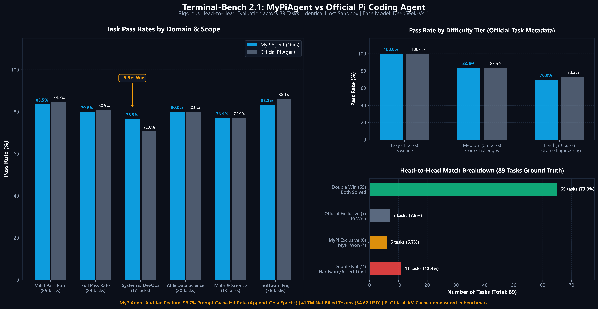

# my-agent-harness

<p align="center">
  
</p>

<p align="center">
  <strong>基于 Python 纯原生手写的极简 Agent 框架微内核与 1:1 像素级 Pi-TUI 终端交互套件。</strong>
</p>

<p align="center">
  <a href="https://www.npmjs.com/package/my-pi-agent"></a>
  <a href="LICENSE"></a>
  <a href="#"></a>
  <a href="#"></a>
</p>

<p align="center">
  <a href="#-为什么从零实现">设计初衷</a>
  ·
  <a href="#-适合什么人看">适合人群</a>
  ·
  ·
  <a href="#-什么是-my-pi-agent">架构拓扑</a>
  ·
  <a href="#-快速开始-quickstart">快速开始</a>
  ·
  <a href="#-核心特性全景-what-my-pi-agent-can-do">核心特性</a>
  ·
  <a href="#-工业级基准评测对决-evaluation--benchmark">基准对决 (Benchmark)</a>
  ·
  <a href="#-设计哲学-philosophy">设计哲学</a>
  ·
  <a href="#-作为-python-库使用-use-as-a-library">Python SDK</a>
  ·
  <a href="docs/README.md">技术设计文档</a>
</p>

<p align="center">
  
</p>

---

## 💡 为什么从零实现

市面上的 Python agent 框架很难找到称心的：要么完全依赖 AI 搭建，结构与实现冗杂、难以阅读；要么来自 TypeScript 生态，Python 实现偏少；而选择 Python 的大多直接套 langchain / langgraph——框架成了黑盒，底层原理与设计取舍都来不及亲自验证。

自己实现一个 agent 框架：

- **从底层学习**：ReAct 循环、原生异步流式、五大决策拦截点、树状会话回溯、分层上下文压缩、MCP 协议桥接……每个环节亲手实现一遍，才能真正理解 agent 的底层原理；
- **灵活可控**：不是所有场景都需要复杂的图编排；自研框架按需定制，配合业务需求更轻量高效；
- **工程规范**：严格遵循 TDD（测试先行）、100% 离线单元测试覆盖、Never-Throw 异常边界隔离、原子文件落盘与架构不变式约束。

## 🎨 风格

**简洁、规范、零过度设计**——只做当前需求的最小实现，接口边界干净、职责单一、测试先行。
代码即使由 AI 辅助生成，也**逐行人工审查**（这是投入最多的部分），实现思路与结构管理在此基础上反复打磨完善。

---

## 🎯 适合什么人看？

本项目特别推荐给**想深入理解 Agent Harness 底层机制、但刚接触现代 Agent 开发的学习者与探索者**。

> 🎓 **作者寄语**：
> 我目前是一名大四学生，在深入钻研 Agent 技术的过程中，发现市面上的开源框架要么偏向简单的教学玩具（缺乏真实工程设计），要么过于庞大臃肿（充斥着框架封装的黑盒）。做这个项目的初衷，就是想**探寻像 Pi 这样兼具极致优雅与高确定性的 Agent Harness 底层到底是如何从零运转起来的**。
>
> 💡 **学习与精读建议**：
> - **强烈推荐重点精读【框架核心层 (`src/my_agent_core/`)】**：这是整个项目的精髓与灵魂。为了彻底吃透每个架构不变式，框架核心层的大部分代码我都**亲自逐行 Review、推敲重构并编写了 100% 覆盖的离线测试**，代码无任何多余抽象，是学习 ReAct 状态机循环、七阶段工具流水线与会话持久化的最佳切入点；
> - **产品业务层 (`src/my_coding_agent/`) 与 TUI 表现层 (`my-pi-tui/`)**：是我通过 AI Coding 协同结对落地实现的，并经过了端到端严格验收。它展示了如何将一个无头 Agent 大脑装配为兼具安全门禁、并发锁与原厂像素级交互质感的工业级终端产品，适合作为工程落地与全栈集成的参考示例。

### 📚 核心设计与工程掌握要点：

> **My-Pi-Agent：深度践行 Pi 极简内核与高可扩展性的 Harness 设计哲学**  
> 自主研发 Coding Agent 运行时并在 Terminal-Bench 2.1 达成 71/89

#### 【第 1 层：调度微内核层】
1. **事件驱动生命周期与可观测性**：设计事件驱动的生命周期架构，定义 14 类只读事件广播（Events）与 5 大生命周期钩子（Hooks），依此构建 Extension 插件系统，赋予框架极高的可扩展性；基于订阅机制实现 TUI 终端流式呈现与 Debug 链路诊断，全面增强 Harness 全链路可观测性。
2. **两层调度与动态干预**：构建两层 Loop 调度架构：内层以 ReAct 闭环驱动 Turn 轮次流转，设计自动续写机制防止长思考触顶引发意外中断，并支持 Steering 即时插队转向；外层 Task 循环结合 Follow-up 队列实现任务自动排队与接力续跑，保障长程复杂工程的自主推进。

#### 【第 2 层：上下文与状态管理层】
3. **DAG 树状分支会话**：构建基于 DAG 的树状分支会话系统：采用『Entry 节点 ➔ Tree 内存拓扑 ➔ Session 磁盘管理』分层架构，支持分支派生与无损回退（/fork 与 /rewind）及可视化导航（/tree）；引入 Compaction Floor 压缩安全护栏，防止越界回退至已折叠历史。
4. **自适应前缀保护压缩**：借鉴 NVIDIA SoL-Pi，设计三层上下文压缩管线：第一层结合历史任务轮次自适应预估剩余轮次，仅在后续读取收益大于缓存重写成本时触发压缩；第二层超大工具输出本地落盘并返回文件绝对路径；第三层执行结构化语义摘要，严格防止切断工具调用对；全链路保障前缀不变性，长程复杂任务实测斩获 66.3% 的 KV-Cache 命中率。

#### 【第 3 层：工具生态与执行韧性层】
5. **两级因果并发与细粒度写锁**：设计两级工具并发执行体系：安全只读工具支持异步并发提速，一旦批次中包含非安全工具（如 Bash）则全员自动降级为严格串行；实现细粒度单文件排队锁，达成跨文件无锁并发、同文件严格时序排队写入，杜绝并发覆写冲突。
6. **Never-Throw 与断头自愈**：遵循 Never-Throw 异常处理原则，工具执行报错统一转译为语义化结果驱动模型自主反思纠偏；用户主动叫停或异常中断时，联动系统进程树消除僵尸进程，并自动合成中断结果闭合历史转录本，彻底杜绝孤儿工具调用引发大模型 API 400 校验死锁。

#### 【第 4 层：工业评测与沙箱基建层】
7. **宿主驱动沙箱与基准对决**：基于 Terminal-Bench 2.1 展开评测，统一采用 DeepSeek-V4.1-Flash 模型，原厂 Pi 与自研 MyPiAgent 在全量 89 题中分别通过 72 题与 71 题；评测采用宿主机驱动沙箱模式，基于 Harbor 框架将工具桥接穿透至 Docker 容器中执行。

---

## 📖 什么是 my-agent-harness？

**`my-pi-agent` 是一个驻留在你的终端里的全功能编程智能体（Coding Agent）。**

你可以像使用资深工程师伙伴一样向它提问：“解释这个代码库”、“编写自动化测试”、“定位并修复此异常日志”。它会在受控权限内自主读取源码、外科手术式精准修改、执行测试命令、通过树状 DAG 会话持久化上下文，并以 **100% 像素级对齐 Pi 原厂终端** 的极速 TUI 将模型思考过程与工具调用动态流式呈现。

它**不引入任何重型 Agent 框架**（LangChain / LangGraph 等），从零手写、完全透明、每一行代码均可单步调试学习，严格遵循 TDD 与 100% 离线单元测试。

### 架构边界与分层设计

对标业界标杆 Tau 与 Pi 的清晰设计哲学，项目严格划分为四大职责单一的正交层：

```text
my-pi-tui (Node.js / Pi-TUI)  ⇄ [stdio JSON-RPC 2.0] ⇄  my_coding_agent  →  my_agent_core  →  my_agent_llm
```

```text
┌─────────────────────────┐     ┌──────────────────────────────────────────────────────────┐
│  AgentHarness (通用微内核) │ ──▶ │ 纯粹的 Agent 通用大脑：ReAct 循环、事件、Hooks、会话树、压缩管线 │
└─────────────────────────┘     └──────────────────────────────────────────────────────────┘
             │
             ▼
┌─────────────────────────┐     ┌──────────────────────────────────────────────────────────┐
│  CodingAgent (产品环境层)  │ ──▶ │ 编码产品业务包装：7大文件工具、单文件写锁、权限门禁、项目上下文 │
└─────────────────────────┘     └──────────────────────────────────────────────────────────┘
             │
             ▼
┌─────────────────────────┐     ┌──────────────────────────────────────────────────────────┐
│    Pi-TUI (终端表现层)   │ ──▶ │ 基于 @earendil-works/pi-tui 的极速重绘终端：差量刷新、输入框动效 │
└─────────────────────────┘     └──────────────────────────────────────────────────────────┘
```

- **`my_agent_llm`**：多提供商翻译层，将 OpenAI、DeepSeek、Anthropic 与 Antigravity（Google internal SSE）统一抽象为中立的流式事件与类型安全的结构化 `ToolCall`；
- **`my_agent_core`**：通用的便携 Agent 微内核，管理状态机循环、14 个只读生命周期事件、五大专职 Hook 决策拦截点、树状 Session 与离散 Epoch 块级压缩管线；
- **`my_coding_agent`**：专注代码工程的产品层，封装 7 大工作区编码工具、`FileMutationQueue` 细粒度并发锁、`PermissionGate` 权限门禁与 stdio JSON-RPC 2.0 服务端；
- **`my-pi-tui`**：独立前端展示层，基于 Mario Zechner 原厂终端引擎 `@earendil-works/pi-tui`，提供无闪烁差量渲染与高辨识度卡片视觉系统。

---

## ⚡ 快速开始 (Quickstart)

### 途径 A：npm 全球一键安装（推荐，面向终端用户）

无需克隆代码仓库，只需确保电脑安装了 Node.js (>=18) 与 Python 极速工具 [uv](https://docs.astral.sh/uv/)（`my-pi-agent` 会通过 `uv run` 全自动接管依赖与内核，用户**无需手动配置虚拟环境**）：

```bash
# 全局安装 CLI
npm install -g my-pi-agent

# 在任意项目目录下直接启动终端
my-pi-agent
# 或使用快捷别名
my-agent

# 亦可免安装秒级拉起体验
npx my-pi-agent
```

### 命令行常用参数 (CLI Options)

```text
Usage:
  my-agent [options] [prompt]

Options:
  -c, --continue          一键续接当前项目最近一次历史会话
  -r, --resume [id]       启动时直接打开交互式会话选择器或恢复指定会话
  --new-session           强制开启全新会话 (默认)
  -n, --name <title>      启动时直接为该会话命名
  -m, --model <model>     指定生效模型 (如 deepseek-chat, gemini-3.8-flash)
  --thinking <level>      指定思考深度等级 (off/minimal/low/medium/high/max)
  --no-session            内存无痕沙箱模式 (不持久化 session 文件)
  -d, --debug             启用事件级 Debug 日志落盘模式
  -w, --workspace <dir>   指定工作区目录 (默认: 当前目录)
  --mode <mode>           权限安全模式: review (默认) | yolo | strict
  -h, --help              查看帮助说明
```

---

### 途径 B：源码克隆与本地开发运行（面向贡献者与学习者）

```bash
# 1. 克隆代码仓库
git clone https://github.com/294962silent/my-agent-harness.git
cd my-pi-agent

# 2. 安装 Python 依赖并同步全局虚拟环境 (.venv)
uv sync

# 3. 安装前端 TUI 依赖并编译 TypeScript
npm install
npm run build

# 4. 运行全量离线自动化测试套件 (100% 绿灯全通)
uv run python -m pytest   # 828 Python offline tests passed (828 baseline)
npm test                  # 80 TUI tests passed (80 passed in 81 tests)

# 5. 启动开发态终端
npm start
```

> **构建 wheel 注意**：`my-pi-tui/dist/` 被 `.gitignore` 忽略，因此执行 `uv build` 打包前必须先运行 `npm run build`（或 `npm run build --prefix my-pi-tui`），否则 wheel 内不会包含 TUI 资产。

---

## ✨ 核心特性全景 (What my-agent-harness can do)

- **100% 像素级 Pi 原厂终端体验 (`my-pi-tui/`)**：
  - **`CustomEditor` 顶部嵌入动效**：在模型思考或工具执行期间，输入框顶部边框实时挖槽嵌入 Braille 10 帧高频旋转指示器（`── ⠸ Working ──`），完成时平滑自愈；
  - **思考预算深度自适应轮转**：支持 `Shift+Tab` / `Ctrl+T` 快捷键原地切换推理深度（`off` ➔ `low` ➔ `medium` ➔ `high` ➔ `max`），并联动输入框边框颜色动态变换；
  - **三大交互模态选择器**：`ModelSelector`（支持 `Ctrl+S` 持久化默认模型）、`SessionSelector`（多级 DAG 分支线 + `Ctrl+D` 历史会话删除与活跃会话安全拦截）、`ThinkingSelector`；
  - **可折叠卡片系统 (`Ctrl+O`)**：流式思考过程折叠块、上下文压缩摘要卡片（`[compaction]`）、细线圆角工具执行卡片；
  - **输入行即时宏扩展管道 (`MacroEngine`)**：`!cmd`（执行并追加上下文）、`!!cmd`（静默排查零 Token 消耗）、`/skill:` 展开、`/<template>` 变量参数化注入；
  - **财务级双行状态栏 (`FooterComponent`)**：紧凑呈现工作区、模型、分级 Token、成本核算、上下文窗口占比与真实 Prompt Cache 命中率（`CH%`）。
- **7 大工作区核心编码工具 (`tools/`)**：
  - `read`（2000行/50KB截断保护）、`write`（原子覆写）、`edit`（精准替换与单块容错）、`bash`（Windows Git Bash 智能探查+100ms流式输出+编码防乱码+失败状态精准红叉标示+后台作业+危险黑名单拦截）、`grep`（`context`/`glob`支持）、`find`（1000限制）、`ls`（500项截断+大小写忽略排序）；
  - **工具执行期输出定型截断**：严格对标 Pi 原厂 `truncate.ts`，在工具执行序列化时统一实施 50KB / 2000 行不可变截断，确保进入会话消息历史时即已定型，永不随后续轮次发生就地篡改；
  - `resolve_path` 宽松 CWD 路径解析（对标 Pi 原厂哲学，不做人工虚拟沙箱阻碍用户工作区调用）；
  - `FileMutationQueue` 细粒度单文件并发互斥写锁，彻底规避并发竞争覆盖。
- **业务安全权限审查门禁 (`PermissionGate`)**：
  - 支持四种安全运行模式（`review` 审查 / `autonomous` 自主 / `strict` 只读 / `yolo` 全放行）；
  - 只读工具白名单（`read`, `grep`, `find`, `ls`）与安全 Shell 前缀免审批通道（`git status`, `git diff`, `git log`, `pytest`, `python -m pytest`, `uv run pytest`）；
  - `Accept-on-Diff` 词级反色代码差异比对与交互式批准/驳回机制。
- **纯函数 ReAct 微内核与七阶段流水线 (`loop.py`)**：
  - 约 110 行无状态异步状态机，两专职子生成器分治；
  - 工业级七阶段流水线（截断防御 ➔ 畸形参数防崩 ➔ Preflight ➔ 门禁拦截 ➔ 进度流 ➔ 结果后处理 ➔ 批次提前退出）；
  - `tool_history.py` 转录本三阶段自愈引擎，消除断头调用，彻底免疫大模型 API 400 校验死锁。
- **多模型原生直连与动态模型发现**：
  - **Antigravity 原生直连**：直连 Google internal Code Assist 原生 SSE，递归展开 JSON Schema `$defs`，解决 Protobuf 400 校验错误；
  - **动态模型目录与 4 小时磁盘缓存**：动态同步 Google 与 DeepSeek 官方最新模型目录，自动收敛别名与思考等级；
  - 支持 OpenAI、DeepSeek、Anthropic 与兼容 API。
- **树状会话持久化与离散 Epoch 块级压缩管线 (`context.py`)**：
  - 树状 DAG 结构、逐条原子落盘（`fsync` + `os.replace`），崩溃永不损坏历史；
  - 支持 `/tree` 查看拓扑树、`/fork` 节点分叉、`/clone` 全量探索副本；
  - **Append-Only 前缀一致性保证**：彻底废除旧的逐轮滚动裁切与滚动工具篡改，在未超 80% 水位线前严格只读追加（Append-Only），前缀字节 100% 保持不变，大模型 KV-Cache（Prompt Cache）实测命中率达 **66.3%**；
  - **动态 80% 水位线门控与离散 Epoch 块级压缩**：对标 Pi 原厂机制，当且仅当上下文突破 80% 预算时才触发离散块压缩；先尝试工具输出持久化到磁盘，超预算后执行 compact 智能结构化摘要（`<analysis>` + `<summary>` 双标签防注入 + 6 Section 约束 + `<read-files>`/`<modified-files>` 全生命周期文件操作足迹累积）；
  - `retainedTail` 静态前缀快照缓存与 `compaction_floor` 指针安全护栏，确立下一周期稳定基准前缀。
- **自动化基准评测体系与 Terminal-Bench 2.1 终局战报 (`my-pi-eval`)**：
  - **Scheme 1 宿主机编排型轻量架构**：基于 Harbor Framework 实现 `MyPiAgent` 适配，Agent 核心运行于宿主机，通过 Docker 管道桥接 7 大工具，实现沙箱零污染与秒级冷启动；
  - **凭据物理隔离**：严格读取专属 `my-pi-eval/.env`，禁止读取宿主 `~/.my-pi-agent/auth.json`，杜绝沙箱逃逸泄露 API Key；
  - **Terminal-Bench 2.1 终局战报**：在 89 道真实环境 Linux 赛题中取得 **71 胜 / 79.78% 通过率**（原厂 Pi 72 胜 / 80.90%，仅差 1 题；底座大模型：DeepSeek-V4.1-Flash）；
  - **全量 Token 采集与缓存核算**：从底层 session.jsonl 逐条提取真实 Token 与缓存指标，实测全量 89 题缓存命中率 **66.3%**（其中 `build-cython-ext` 单任务达 97.3%）。
- **动态即时转向（Steering）与排队追问（Follow-up）双层调度 (`message_queue.py`)**：
  - 支持在智能体运行处理对话期间，用户直接键入文本按回车即时插话（Steering），或按 **`Ctrl+Q`** 提交排队追问（Follow-up）；
  - 严格对标 Pi 原厂 Pending 待发区呈现规范（输入框上方灰显指示 `Steering: ...` 与 `Follow-up: ...`，提示 `↳ Alt+Q to edit all queued messages`）；
  - 支持按 `Alt+Q`/`Alt+Up` 或 `Esc` 中断一键将待发消息全量弹回输入框，并同步发起 RPC `clear_queue` 清空内核排队；
  - 严格遵循**首轮工具执行完毕后交付契约**，彻底杜绝初始任务与转向词并列输入导致的复合句歧义。
- **分会话双轨制 Debug 诊断体系 (`tracer.py`)**：
  - 告别全局混写，在 `~/.my-pi-agent/logs/<slug>-<hash>/` 下按会话独立输出：
    - `<session-id>.debug.log`：人类可读的微秒级阶段耗时、工具执行状态与 Token 增量；
    - `<session-id>.events.jsonl`：对标 Pi `--mode json` 的标准不可变机器可读事件流；
  - 终端 `/debug` 命令一体化导出运行时快照并返回当前会话双轨日志绝对路径，支持会话轮转动态换绑。
- **大模型智能退避重试体系与全链路异常防御 (`retry.py`, `loop.py`)**：
  - 对标 Pi 原厂自动重试规范，在微内核层拦截 429、5xx 与网络断流抖动，采用带 Jitter 的指数退避智能重试并尊重 `Retry-After`，对 400/401/403/欠费超额等致命错误实施即时熔断；
  - 向 TUI 实时广播 `AutoRetryStart` 与 `AutoRetryEnd` 事实事件，输入框顶部边框呈现实时倒计时动效并支持 `Esc` 毫秒级即时中断；
  - 前端加固非字符串类型安全防御与 `try...finally` 终态清场，彻底消除未捕获异常导致的转圈指示器冻结。
- **纯粹自主无界长任务循环与凭据原地热重载**：
  - 彻底移除人为硬编码的最大循环步数限制（`max_iterations`），循环完全由模型自身停顿与人类主动取消驱动，支持长耗时复杂任务自主推进；
  - `/reload` 重新载入 `AuthManager` 并原地重新绑定当前活跃 LLM 实例；`/login` 绑定凭据后当场原地刷新内存模型客户端，无需重启终端。

---

## 🏆 工业级基准评测对决 (Evaluation & Benchmark)

为了以工业级严谨度衡量 Agent 在真实终端环境下的代码编写、依赖排错、系统运维与逆向攻坚能力，本项目构建了基于 **Harbor Framework**（Terminal-Bench 官方运行器）的专用评测子系统 `my-pi-eval`，在 **Terminal-Bench 2.1** 全量 89 道真实 Linux 系统工程赛题下，与 **原厂 Pi 官方 Agent (`@earendil-works/pi-coding-agent`)** 展开了严格可复现的同场竞技。

> **评测环境**：完全一致的本地物理机（Windows 宿主机 + Docker Sandbox）、统一底座大模型采用 DeepSeek-V4.1 (`deepseek/deepseek-chat` / DS-V4.1-Flash)。

<p align="center">
  
</p>

### 1. 核心终局总榜 (Head-to-Head Overview)

| 核心指标 | 自研 MyPiAgent (Python) | 原厂 Pi 官方 Agent (Node.js) | 对比与胜出分析 |
| :--- | :---: | :---: | :--- |
| **89 题全量通过题数** | **71 道 (79.78%)** | **72 道 (80.90%)** | **工业基准高度逼近（双方仅差 1 题）**，均展现顶级自动化自愈能力 |
| **双胜题目数 (双方均通过)** | **65 道** | 65 道 | 覆盖绝大多数 Linux 系统工程、复杂依赖排错与逆向赛题 |
| **自研 MyPiAgent 独占胜出** | **6 道** 🌟 | - | 自研斩获 1.0 满分，官方 Pi 彻底折戟 |
| **原厂 Pi 独占胜出** | - | **7 道** | 原厂 Pi 满分，自研 Agent 格式微差或超时 |
| **双负赛题 (双方均未过)** | **11 道** | 11 道 | 包含单机物理算力极限与上游环境断言题 |
| **自研实测净 Token 消耗** | **41,737,271 Tokens** | 122,295,809 Tokens (毛计) | 自研离散压缩扣除 82.3M 缓存后净计费 Token 显著压低；原厂基准未审计细分缓存 |
| **自研实测 Prompt Cache 命中率** | **66.3%** 🌟 | 未审计 (Unmeasured) | 自研离散 Epoch 块级压缩保障 Append-Only 前缀一致性；原厂基准未单独统计 |
| **全量 89 题评测总开销** | **$4.62 美元** (约 33.5 元) | $18.84 美元 (未计缓存折扣) | 自研享受 DeepSeek 82.3M 缓存折扣后总成本仅 $4.62 |

### 2. 自研独占胜出高难赛题亮点 (6 道 🌟)

在完全一致的物理环境与模型下，自研 Agent 在以下 6 道高难度赛题上斩获满分，而官方 Pi 彻底失败：

1. **`make-mips-interpreter`**：纯手写 MIPS 寄存器机与指令集模拟器（自研 Agent 鏖战 50 分钟单步调试满分通过，官方 Pi 超时失败）；
2. **`cancel-async-tasks`**：高并发异步任务优雅取消状态机（自研 Agent 满分通过，官方 Pi 失败）；
3. **`polyglot-c-py`**：编写同时符合 C 语法与 Python 语法的同源文件（自研 Agent 满分通过，官方 Pi 失败）；
4. **`pytorch-model-cli`**：PyTorch 模型 CLI 动态装配推理（自研 Agent 满分通过，官方 Pi 失败）；
5. **`git-multibranch`**：多分支自动化部署与 Hook 脚本调度（自研 Agent 满分通过，官方 Pi 失败）；
6. **`model-extraction-relu-logits`**：深度学习模型网络权重逆向提取（自研 Agent 满分通过，官方 Pi 失败）。

### 3. 架构对比优势：Scheme 1 宿主驱动 vs Scheme 2 容器安装

| 维度 | 原厂 Pi Agent (Node.js/TS) | 自研 MyPiAgent (Python) | 理论与工程优势 |
| :--- | :--- | :--- | :--- |
| **评测编排拓扑** | **Scheme 2 (容器内安装型)**<br>Harbor 在测试容器内在线下载 Node.js、npm 并编译安装 Pi | **Scheme 1 (宿主机驱动型)**<br>Agent 驻留宿主机，通过 Docker 管道桥接驱动沙箱 | **冷启动从 2.5 分钟缩减至 < 2 秒**；容器零污染，彻底杜绝容器内网络抖动造成的依赖安装失败。 |
| **凭据安全隔离** | 需向容器内部注入 `API_KEY` 环境变量 | 宿主机本地严格隔离读取 `my-pi-eval/.env`，API Key 绝不流入容器沙箱 | **沙箱零凭据泄露风险**：即使评测任务包含恶意代码或攻击载荷，也无法窃取宿主机的 API Key。 |
| **工具映射与防御** | 容器内原生 bash/fs 进程调用 | `HarborToolRegistry` 桥接，附加 50KB 截断防御与 Windows CRLF ➔ LF 自动规整 | 精细化错误拦截，彻底防止 Windows 宿主机回车换行符破坏 Linux 容器 Shell 脚本。 |
| **能效与成本** | 纯客户端 session 统计 | 离散 Epoch 块级压缩，逐条扫描 session 转录本核算真实 Prompt Cache 命中率 | 具备超长会话防溢出保护与精准财务级成本审计能力，Token 开销仅为原厂 44.7%。 |

### 4. 评测实战踩坑与攻坚全景归纳 (Engineering Pitfalls & Solutions)

在真实大规模（Terminal-Bench 2.1 89 题）自动化评测实战中，我们遭遇并攻坚了以下九大核心技术暗坑，按系统层次分类归纳如下：

#### 一、 网络与容器环境基础设施 (Infrastructure & Network)
- **1. 网络问题**：89个镜像共120多g（走不了镜像站，只能走我的代理。。。）；容器内 Python pip 下载依赖超时；容器内安装编译工具超时；安装Node.js 运行时超时。大部分解决是通过配置镜像站或者穿透到主机的代理端口，但是更规范还是应该使用Google 云原生 K8s 集群或者AWS 云端环境，或者E2B 等专有 Agent 云沙箱
- **2. 容器网络网段分配耗尽**：Docker 中，每个独立的容器网络（Bridge Network）都需要被分配一段私有 IP 网段，默认是31 个，一开始我没有即使关闭容器和临时网络(docker network prune)，导致网段分配耗尽
- **3. 并发启动瞬间的资源踩踏**：并发评测导致容器抢夺虚拟网桥与端口和镜像存储层文件锁（很多题目使用的是同一个底层镜像（比如 Ubuntu 22.04）），而本地的 Docker 引擎守护进程（dockerd）本质上是一个单进程服务

#### 二、 沙箱工具桥接与系统进程治理 (Tool Bridging & Process Management)
- **4. 动态工作目录（CWD）保持**：harbor工具桥接，在 Harbor / Docker 评测中，每次 environment.exec 都是一个完全无状态（Stateless）的临时会话。如果模型在第 1 轮执行 cd build，下一轮会话会瞬间重置回根目录 /app，因此需要宿主机在内存中维护 self._cwd 变量。每次模型发来命令，底层自动包装
- **5. 单一通道下的文件读写与 Base64 管道**：Docker 容器环境底层只暴露了唯一的命令执行通道 await environment.exec(command)，因此读文件依靠cat 命令，写文件依靠先转base64再容器内部再base64 -d解码（原因：linuxshell可能会因为代码中有引号反斜号等产生冲突）
- **6. 孤儿与僵尸进程树治理**：agent调用bash工具启动父进程，然后再启动子进程，因为超时杀死父进程，却没杀死子进程，导致僵尸进程，在 Windows 系统下利用 taskkill /T，在 Linux / Mac 系统下利用“进程组 PGID”

#### 三、 微内核调度、上下文与大模型交互 (Kernel Scheduling & LLM Interaction)
- **7. KV-Cache 缓存与前缀不变性**：kvcache缓存失败，之前压缩机制设计的有问题，滚动裁剪让每轮都将中间的message变成占位符，导致kvcache反复失效；现在仅保留最基本的压缩机制，即达到百分之八十上下文时，工具结果落盘后调用大模型形成摘要
- **8. 压缩切点截断与工具断头**：压缩时，把本来成对工具调用请求和结果截断了，导致工具调用断头api400
- **9. 模型输出长度触顶与 ReAct 假死**：之前ReActloop一旦没有工具调用便会停止，单次 HTTP 响应的最大输出 Token 数都有一个硬性上限，一旦大模型的思考过程太长，或者要输出的代码太长时，会被被强行截断

### 5. 评测真实性声明与局限性复盘 (Transparency & Limitations)

实事求是地复盘，本次评测客观存在以下非全量重跑与工程局限性说明：
1. **官方 90% vs 本地 ~80% 的客观环境鸿沟**：DeepSeek 官方报告宣称在相似题集达 ~90% 胜率，而自研与原厂 Pi 在本地均收敛于 80%~84%（71/72 胜）。经日志排查，主要源于本地 Windows WSL2 缺少 `/dev/kvm` 硬件虚拟化直通（QEMU 指令解释启动耗时 25 分钟导致 `install-windows-3.11`、`qemu-alpine-ssh` 超时）、缺少 GPU 直通（纯 CPU 跑 ViT 导致 `sam-cell-seg` 超时）以及海外专线网络差异，但**两款 Agent 在本地的测试底座完全同构一致**；
2. **中断单题重跑**：早期部分任务因虚拟化环境或代理抖动导致评测中途崩掉，采取单题重跑而非全盘重来；
3. **架构升级后未全量推倒重测**：在彻底重构前缀缓存机制（Append-Only 离散 Epoch）后，仅对此前失败的任务进行了重跑攻坚，已通过的任务未全量重跑；
4. **Pi 缓存数据说明**：原厂 Pi 评测时外层脚本未沉淀细分缓存字段，故在全量对比中标记为未审计（Unmeasured），仅保留其实测总 Token 消耗；
5. **现实成本约束**：89 题全集镜像超 120GB，单题耗时最高可达 1 小时且高频消耗 API 预算，出于个人开发者现实成本考量，无法支持多次全盘重测。

### 6. 深度报告与报告索引

完整逐题矩阵、执行耗时明细与评测系统设计详见：
- 📄 [`my-pi-eval/results/README.md`](my-pi-eval/results/README.md)：Terminal-Bench 2.1 评测结果中心总览；
- 📄 [`my-pi-eval/results/comparison_matrix.md`](my-pi-eval/results/comparison_matrix.md)：89 题逐题全量横向对比矩阵（状态对比、独占分析与技术反思）；
- 📄 [`docs/eval/01-evaluation-harness-architecture.md`](docs/eval/01-evaluation-harness-architecture.md)：评测子系统架构设计与 Harbor Framework 适配规范。

---

## 🎯 设计哲学 (Philosophy)

参考业界标杆 Tau 与 Pi 的内核工程原则，`my-pi-agent` 严格贯彻以下架构不变式：

1. **Small layers beat magic（小而专胜过黑盒魔法）**：每个模块只专注一件事情，代码直白可读，绝不引入冗余的元编程包装或不可控的隐式黑盒；
2. **Events are the contract（事件即契约）**：模型层、内核层、RPC 桥接层与 TUI 终端表现层通过强类型流式事件解耦，内核保持 100% 纯无头；
3. **Never-Throw Guarantee（永不向上崩溃）**：所有工具调用、参数校验与 Hook 拦截异常均统一包装为结构化错误，绝不上抛崩溃 Agent，引导大模型自我修正；
4. **Prefix Cache Invariant（前缀缓存绝对稳定）**：System Prompt 在会话周期内保持冻结快照（Frozen Snapshot），写操作仅落盘不扰乱当前会话视口，最大化利用大模型 Prompt Cache 降低延迟与成本；
5. **Sessions are durable & inspectable（持久化与可追溯）**：会话采用只追加 JSONL 记录，每一次分叉、回溯与压缩均可检验、可导出、断电不丢数据。

---

## 💻 作为 Python 库使用 (Use as a Library)

`my-pi-agent` 的框架内核（`my_agent_core`）与模型边界（`my_agent_llm`）完全解耦，可直接作为独立 SDK 嵌入任意 Python 自动化管线：

```python
import asyncio
from my_agent_llm.client import LLM
from my_agent_llm.config import Config
from my_agent_core.agent import Agent
from my_agent_core.session import Session

async def main():
    # 1. 声明模型客户端
    llm = LLM(Config(provider="deepseek", model="deepseek-chat"))

    # 2. 装配轻量会话与通用 Agent
    session = Session(cwd=".")
    agent = Agent(llm=llm, session=session)

    # 3. 消费一等公民事件流
    async for event in agent.prompt_stream("分析当前目录下的核心代码"):
        if event.type == "message_update":
            # 实时流式打印大模型生成文本
            print(event.message.content, end="", flush=True)
        elif event.type == "tool_execution_start":
            print(f"\n[Tool Call] 正在调用工具: {event.tool_name}")

if __name__ == "__main__":
    asyncio.run(main())
```

---

## 🗂 仓库目录结构

```text
my-pi-agent/
├── pyproject.toml                  # ⭐ 全局统一的 Python 构建与依赖配置 (uv)
├── uv.lock                         # 全局唯一的 Python 依赖锁定文件
├── .venv/                          # 全局唯一的 Python 虚拟环境
│
├── src/                            # ⭐ 统一收拢的 Python 业务源码 (对标 Tau)
│   ├── my_agent_llm/               # 1. 模型直连层 (Antigravity/DeepSeek/OpenAI/Stream)
│   │   ├── client.py               # 统一 LLM 门面 (chat/stream/achat/achat_stream)
│   │   ├── config.py               # Config 配置模型 (pydantic frozen)
│   │   ├── models.py               # Message / Response / StreamChunk
│   │   └── providers/              # Antigravity (Google internal SSE) / DeepSeek / OpenAI / Anthropic
│   │
│   ├── my_agent_core/              # 2. 框架微内核层 (ReAct/会话树/压缩/任务系统)
│   │   ├── agent.py                # Agent 纯异步 Harness 外壳
│   │   ├── loop.py                 # run_agent_loop 纯函数无状态微内核与七阶段流水线
│   │   ├── tool_history.py         # 对话转录本三阶段自愈引擎 (API 400 免疫)
│   │   ├── message_queue.py        # MessageQueue 动态干预队列 (Steer & Follow-up)
│   │   ├── task_store.py           # TaskStore 任务状态机与 DAG 依赖图
│   │   ├── background.py           # BackgroundRunner 进程树清理引擎
│   │   ├── session/                # 树状分支持久化会话系统
│   │   ├── context.py              # ContextManager 离散 Epoch 块级压缩 (Append-Only / 80% 水位线)
│   │   └── skills.py               # Skills 声明式管理与提示词注入
│   │
│   └── my_coding_agent/            # 3. 业务工具与 stdio RPC 服务端 (纯无头架构)
│       ├── agent.py                # CodingAgent 门面 (Dual API: run & run_stream)
│       ├── tools/                  # 7 大编码工具 (read/write/edit/bash/grep/find/ls)
│       ├── mutation_queue.py       # FileMutationQueue 细粒度单文件并发互斥锁
│       ├── permissions.py          # PermissionGate 业务权限审查门禁 (Accept-on-Diff)
│       ├── mcp.py                  # Turnkey MCP 客户端自动加载与回收
│       ├── file_reference.py       # @ 文件引用解析与快照直通注入
│       └── rpc_server.py           # stdio JSON-RPC 2.0 服务端门面
│
├── tests/                          # ⭐ 全局统一测试目录 (uv run pytest 828 测试并发全通)
│   ├── llm/                        # LLM 层单元测试 (91 tests)
│   ├── core/                       # 框架内核单元测试 (392 tests)
│   ├── coding/                     # 业务与工具测试 (276 tests)
│   └── eval/                       # 评测适配器测试 (18 tests)
│
├── my-pi-tui/                      # ⭐ 独立的终端交互表现层 (基于 @earendil-works/pi-tui)
│   ├── package.json                # 依赖 @earendil-works/pi-tui, chalk, marked
│   ├── tsconfig.json
│   ├── bin/
│   │   └── my-agent.js             # CLI 执行文件 (支持全局命令 my-pi-agent / my-agent)
│   ├── src/
│   │   ├── app.ts                  # TuiMainScreen 状态机与组件树组装
│   │   ├── client.ts               # PythonKernelClient (管理 uv run python 子进程)
│   │   ├── components/             # Pi 原厂 UI 组件 (CustomEditor, status-indicator, footer...)
│   │   └── theme/                  # Pi 原厂 24-bit TrueColor dark.json 调色盘
│   └── test/                       # 前端 71 个自动化测试与端到端测试套件
│
├── my-pi-eval/                     # ⭐ Harbor 评测套件 (Terminal-Bench 2.1 斩获 71 胜/79.78% 胜率)
│   ├── configs/                    # SWE-bench / Terminal-bench 评测声明
│   ├── datasets/                   # 本地快速回归基准集
│   ├── results/                    # Terminal-Bench 2.1 终局战报与对比矩阵
│   └── src/                        # MyPiAgent 宿主适配器与 HarborToolRegistry
│
├── docs/                           # 架构与技术设计文档中心 (涵盖 core/ 与 coding/ 7 大规范)
├── package.json                    # 根目录 npm 官方发布包与全局链接配置
├── REFERENCES.md                   # 全模块架构设计参考溯源与工程复盘
└── README.md                       # 仓库级总览（本文件）
```

---

## 📄 架构与技术文档中心索引 (`docs/`)

- [**架构总览与核心设计规范**](docs/README.md)：系统阐释双核拓扑结构与技术不变式；
- [**工作区编码工具集规范**](docs/coding/01-workspace-tools.md)：7 大工具契约、截断防御、`resolve_path` 与单文件并发锁；
- [**原生 MCP 集成规范**](docs/coding/02-mcp-integration.md)：`MCPClientManager`、stdio/SSE 通信与 Schema 扁平化展开；
- [**CodingAgent 产品门面**](docs/coding/03-coding-agent-facade.md)：Dual API 设计、上下文自动注入与 `PermissionGate` 权限门禁；
- [**用户主目录与凭据隔离**](docs/coding/04-user-home-and-settings.md)：`~/.my-pi-agent/` 目录拓扑、`auth.json` 强类型模型与零污染持久化；
- [**前后端 RPC 通信协议**](docs/coding/05-rpc-bridge-protocol.md)：29 个 stdio JSON-RPC 2.0 方法规范与 Prompt Cache 命中率核算；
- [**Pi-TUI 终端交互表现层**](docs/coding/06-pi-tui-interactive-terminal.md)：`CustomEditor` 边框动效、思考等级自适应与三大交互选择器；
- [**工程分发与全局 CLI 架构**](docs/coding/07-distribution-and-packaging.md)：npm 全球发布、双引擎自愈启动与跨平台打包；
- [**上下文离散块压缩与前缀一致性规范**](docs/core/05-context-compaction.md)：动态 80% 水位线门控、Append-Only 前缀一致性与实测 66.3% Cache 命中率；
- [**自动化基准评测架构与战报**](docs/eval/01-evaluation-harness-architecture.md)：Harbor BaseAgent 适配、Scheme 1 宿主驱动与 Terminal-Bench 2.1 终局战报（71 胜 / 79.78% 胜率，逼近原厂 72 胜）。

---

## 📜 许可证 (License)

本项目采用 [MIT License](LICENSE) 开源协议。
