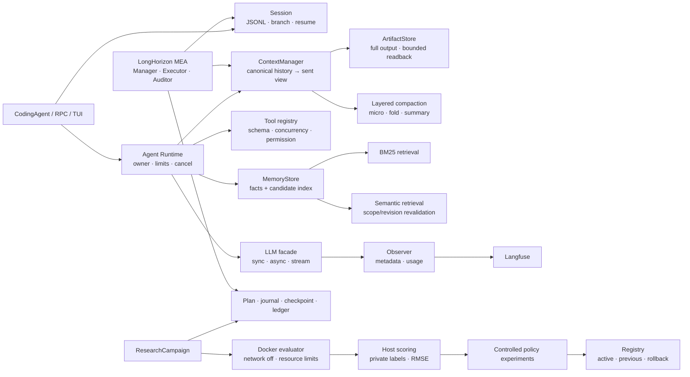

# my-agent-harness

**面向长程代码任务的可审计 Agent 执行框架**

`my-agent-harness` 在常规“模型调用 + 工具循环”之外，补齐长任务最容易失控的执行状态：上下文证据、跨会话记忆、进程恢复、请求预算、评分权限和策略晋升。

项目提供 Python Agent Runtime、CodingAgent、RPC、终端 TUI、容器化代码实验入口，以及区分离线回归、真实模型和公开任务的实验体系。

## 核心能力

| 模块 | 解决的问题 |
|---|---|
| 执行与调度 | 多轮任务续跑、取消传播、轮次与时长限制、工具并发和文件写冲突 |
| 上下文治理 | 默认五层压缩、artifact 全文存储与有界回读、摘要来源校验 |
| 长期记忆 | 权威事实与可重建语义候选索引分离，支持版本、作用域校验和词法降级 |
| 沙箱评分 | 固定 Docker 镜像、受限候选工作区、宿主私有标签重算指标 |
| 恢复与观测 | JSONL journal、checkpoint、预算预留/结算、Langfuse 元数据 tracing |
| 长程执行层 | Manager → Executor → Auditor、verified state、fresh context、checkpoint/recover |

## 架构



依赖方向保持为“产品入口 → Runtime / Agent → Model、Tools、Session、Context、Memory”。实验代码调用产品接口，生产模块不反向依赖实验脚本。

## 一次代码实验如何执行

1. ResearchCampaign 冻结任务、数据切分、镜像、模型、评分器与预算。
2. ledger 在锁内预留 request、token、active seconds 和 evaluation 额度。
3. Agent 在只包含 `train.py` 的候选工作区执行。
4. 固定 Docker 镜像以无网络、只读根和资源配额运行候选。
5. 容器只写 `predictions.csv`；宿主检查 ID、schema 和有限数值。
6. 宿主使用候选不可见的私有标签重算 RMSE。
7. 只有请求结算、工具配对、资源清理和 checkpoint 可核验后，round 才提交。
8. final 在冻结产物上独立执行，结果不会回到选择或训练阶段。

## 核心模块

### 执行与调度

- `Agent.run()`、`prompt_stream()` 和 `abort()` 提供同步、流式与取消入口。
- `RunLimits` 管理最大轮次与时长；一次直接运行只有一个 owner。
- 取消会传播到生成器、工具任务和 owned 资源。
- 安全只读工具可以并发；有副作用或存在依赖关系的工具按批次串行。
- `FileMutationQueue` 串行化同一路径的 read-modify-write，避免 lost update。
- 工作区之外的写入在副作用发生前由权限层阻断。

### 默认五层上下文压缩与 artifact 回读

产品设置默认启用 `layered` 上下文压缩，按实际预算逐级执行：

1. **摘要来源校验**：canonical 历史、分支、摘要覆盖范围和 fingerprint 必须一致。
2. **大输出 artifact 化**：工具结果完整落盘，发送视图只保留预览和 artifact handle。
3. **闭合工具组微压缩**：只压缩已闭合、成功且不在最近窗口内的工具组。
4. **完成段前缀折叠**：宿主登记明确完成边界后，折叠该段并保留结构化摘要。
5. **有界语义摘要**：仍超预算时生成受预算约束的摘要；没有安全投影则失败关闭。

完整 Session 正文保持 canonical；发送视图是临时投影。artifact 支持 Unicode-safe 分页、受限搜索、owner 隔离、路径逃逸检查和内容 hash 校验。

### 长时记忆与检索

MemoryStore 采用“本地权威事实 + 可重建候选索引”的结构：

- 事实保存在本地存储中，支持同 identity 版本替换、去重、来源、删除、脱敏和 scope 隔离。
- 读取可以走 BM25，也可以接入 CPU 或隔离 GPU worker 的语义候选索引。
- 语义候选返回后重新校验 scope、identity 和 revision，再从权威源读取正文。
- 语义索引异常时自动回退词法路径。
- 候选索引负责召回，权威事实决定最终内容。

### Docker 沙箱与宿主评分

- 候选工作区只允许 `train.py`。
- Docker 限制网络、CPU、内存、PID、根文件系统和输出路径。
- 容器只能生成 `predictions.csv`。
- 宿主验证 schema、行数、ID 和有限数值，并用容器外标签重算 RMSE。
- 越界写入、额外文件、非法 schema 和不可评分输出会被拒绝。
- 固定镜像、运行参数和评分器源码身份在执行前冻结。

### 恢复、预算与观测

- 每次模型请求先 reservation，收到可靠 usage 后 settlement。
- append-only JSONL journal 使用 hash chain 保存状态。
- checkpoint 绑定代码、结果与评分身份，新进程可以恢复 root id、预算累计和未完成步骤。
- 未知 usage 或 in-flight 状态阻止后续派发。
- LLM 门面统一记录 call/root/parent、purpose、model、耗时、状态与归一化 usage。
- Langfuse 发送 metadata-only generation；required observation 在 flush/export/drop/close 异常时失败关闭。

## 快速开始

需要 Python 3.11+、uv、Node.js 和 npm。

```sh
git clone https://github.com/294962silent/my-agent-harness.git
cd my-agent-harness

uv sync --frozen
npm ci
npm run build

uv run my-pi-agent --help
```

## 可恢复的 CLI 长程任务

`lh-longhorizon` 在现有 Agent 之外增加一层 MEA 调度：

1. 无工具 Manager 把原始任务拆成一个有界子任务。
2. Executor 使用独立 Session 执行子任务。
3. 只读 Auditor 独立检查真实文件、测试和证据。
4. 只有 clean audit 才更新 verified state。
5. 每轮写入 hash-chain journal 和 content-addressed checkpoint。

如果进程在轮次中途中断，`resume` 会 fail closed，而不是自动重放可能已经产生副作用或费用的调用。

```sh
uv sync --extra langfuse

uv run lh-longhorizon run \
  --task @task.md \
  --workspace . \
  --provider openai \
  --model deepseek-v4.1-flash \
  --auth-provider openai \
  --auth-profile default \
  --max-rounds 8 \
  --langfuse

uv run lh-longhorizon status RUN_ID
uv run lh-longhorizon resume RUN_ID
uv run lh-longhorizon follow-up RUN_ID --message @followup.md
uv run lh-longhorizon restore RUN_ID --round 1
```

`status`、`follow-up` 和 `restore` 不加载模型凭据。真实 smoke 证据见 [Long-horizon MEA v1 报告](docs/experiments/reports/longhorizon-mea-v1.md)。

启动终端界面：

```sh
npm start
```

真实模型调用需要单独配置供应商和凭据。密钥不会写入 manifest、journal、日志或 Git。

## 测试

默认回归：

```sh
uv run python -m pytest tests -q
npm test
```

常用聚焦检查：

```sh
uv run python -m pytest tests/core -q
uv run python -m pytest tests/experiments/test_progress_guard_ablation.py -q
uv run python -m ruff check src tests experiments
```

## 离线实验

确定性故障矩阵和 progress guard 不调用付费模型：

```sh
uv run python -m experiments.long_horizon_code.fault_injection \
  --repeat 20 \
  --output artifacts/phase-a-local.json

uv run python -m experiments.long_horizon_code.progress_guard_ablation \
  --repeat 20 \
  --compact
```

通用 Harness 机制回归：

```sh
uv run python -m experiments.harness_eval \
  --suite all \
  --repeats 5 \
  --seed 23 \
  --output artifacts/harness-eval-local
```

真实公开 benchmark、LoCoMo、LongMemEval 与 Terminal-Bench 入口依赖冻结数据、模型、容器和独立预算。运行前请先阅读对应 manifest 与预算文件，不要复用已消费的 run ID。

## 实验结果

完整证据索引与主张边界见 [EXPERIMENT_EVIDENCE_SUMMARY_V2.md](docs/experiments/reports/EXPERIMENT_EVIDENCE_SUMMARY_V2.md)，逐批开发记录见 [HARNESS_EXPERIMENT_LOG.md](docs/experiments/HARNESS_EXPERIMENT_LOG.md)。

| 实验 | 结果 | 证据类型 |
|---|---|---|
| 7 类故障 × 20 | baseline `0/140`；生产接缝 `140/140` | 确定性故障注入 + 真实生产组件 |
| progress guard | baseline `0/20`；guarded `20/20` | 脚本时钟与脚本仓库动作 |
| Wine red runtime | 两轮运行、新进程恢复、独立 final 完成 | 真实 provider + Docker + journal |
| LongMemEval 96 | 注入 `105,316 → 11,983` tokens（−88.6%）；准确率 `71.9% → 69.8%` | 真实模型与模型判分 |
| LoCoMo 30 | lexical / semantic / facts-lexical / facts-semantic = `16/17/12/15` | 真实模型小样本 |
| LoCoMo 独立确认 | lexical / semantic / RRF = `10/12/10` | 冻结 24 题、真实模型 |
| MMR / session cap | top-8 / MMR / cap2 = `9/9/10` | 冻结 24 题、真实模型 |
| 受控策略实验 | 完成 `7/8` final 臂 | 真实模型 + train / holdout / final |
| SWE v2 | on `2/5`；off `1/5` | 5 题、单 trial / 臂 |
| Terminal-Bench fix-git | 三臂 reward `1`；requests `17/10/12` | 公开任务、单题单 trial |
| Terminal-Bench large-scale | `1,080` 秒取消；`22` requests；verifier `0/5` | 公开任务、真实模型 |
| Terminal-Bench custom-memory v4 | artifact-off 预算失败；baseline / enhanced 均 `5/6` | 公开任务三臂 |
| Langfuse | v3+v4 `7 traces / 121 generations` 与 ledger 对齐 | 真实云服务元数据回读 |

### 长程故障矩阵

| 场景 | baseline | 生产 Harness |
|---|---:|---:|
| 大输出与 artifact 证据回读 | 0/20 | 20/20 |
| 记忆 revision / scope | 0/20 | 20/20 |
| checkpoint / resume | 0/20 | 20/20 |
| 同文件并发修改 | 0/20 | 20/20 |
| 受控策略晋升 | 0/20 | 20/20 |
| Docker 宿主评分 | 0/20 | 20/20 |
| 连续仓库修复 | 0/20 | 20/20 |
| **总计** | **0/140** | **140/140** |

### 公开代码任务

Terminal-Bench 2.1 使用固定 revision `12b7565679ce5006230b820666353673a133db93`。`fix-git` 三臂均通过官方验证：

| 实验臂 | compaction | artifact | requests | reward |
|---|---|---:|---:|---:|
| baseline | baseline | off | 17 | 1 |
| enhanced | layered | on | 10 | 1 |
| layered without artifact | layered | off | 12 | 1 |

同一轮还完成两项长任务：

- `large-scale-text-editing` 在 1,080 秒被取消，22 requests 完整结算，官方 verifier 执行但 5 项全部失败。
- `custom-memory-heap-crash` 的 layered-without-artifact 在 24 requests 后触发 `ContextBudgetExceeded`；baseline 与 layered+artifact 均进入 verifier 并通过 5/6，共同失败项为 release 程序 `SIGSEGV`。

v2+v3+v4 共 122 requests，客户端保守估算 `$0.513626`。Langfuse 的 7 个 trace、121 条 generation observation 与请求账本对齐。

## 目录结构

```text
.
├── src/
│   ├── my_agent_llm/       # provider、流、请求投影、观测
│   ├── my_agent_core/      # Agent、loop、tools、session、context、artifact、memory
│   └── my_coding_agent/    # CodingAgent、权限、RPC、实验运行时、宿主评分
├── my-tui/                 # TypeScript 终端界面
├── experiments/
│   ├── harness_eval/       # 统一机制回归
│   ├── long_horizon_code/  # 故障矩阵、progress guard、公开 pilot
│   ├── longmemeval/        # LongMemEval
│   └── memory_validation/  # LoCoMo 与检索实验
├── tests/
└── docs/
    ├── experiments/        # 实验计划、日志、报告与机器结果
    ├── learning/           # 调用链与工程复盘
    └── interview/          # 面试讲解材料
```

## 文档入口

- [实验证据汇总](docs/experiments/reports/EXPERIMENT_EVIDENCE_SUMMARY_V2.md)
- [统一实验日志](docs/experiments/HARNESS_EXPERIMENT_LOG.md)
- [长程代码证据包](docs/experiments/reports/long-horizon-code-6h-results.md)
- [五层上下文压缩说明](docs/context-compaction.md)
- [实验协议与预算](docs/experiments/)

## License

[MIT](LICENSE)
