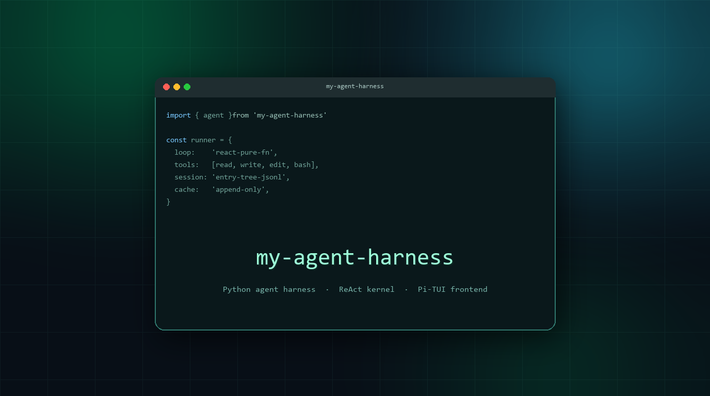
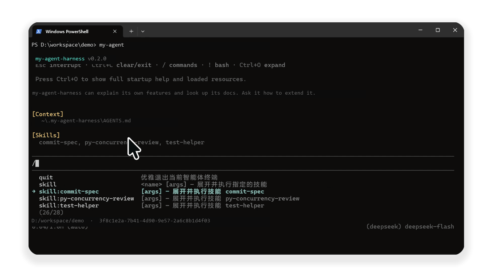
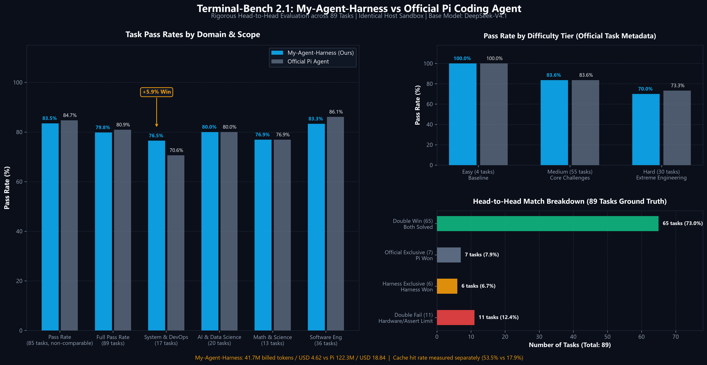

# my-agent-harness

<p align="center">
  
</p>

<p align="center">
  <a href="LICENSE"></a>
  <a href="#"></a>
  <a href="#"></a>
  <a href="#"></a>
</p>

用 Python 从零手写的 Agent 框架：内核（ReAct 循环、会话树、上下文压缩、工具并发）+ 基于 [Pi-TUI](https://github.com/badlogic/pi-mono) 的终端界面。

不依赖 LangChain / LangGraph。目标是把 Agent 各环节亲手实现一遍，并保持每一层都能单独阅读和测试。

```bash
npm install -g my-pi-agent    # npm 包名为历史名
my-agent                      # 启动终端
```

> 数据目录：默认 `~/.my-agent-harness/`；若已存在旧的 `~/.my-pi-agent/` 会自动沿用，避免丢失登录态。也可用 `MY_AGENT_HOME` 指定。

<p align="center">
  
</p>

---

## 结构

```text
my-tui (Node.js / Pi-TUI)  ⇄ [stdio JSON-RPC 2.0] ⇄  my_coding_agent → my_agent_core → my_agent_llm
```

| 模块 | 职责 |
| --- | --- |
| `src/my_agent_llm` | 多 provider 适配层，统一为流式事件与结构化 `ToolCall` |
| `src/my_agent_core` | 通用内核：ReAct 循环、14 类事件、5 个 Hook、会话树、上下文压缩 |
| `src/my_coding_agent` | 产品层：7 个基础编码工具、2 个受限产物回读工具、单文件写锁、权限门禁、stdio RPC 服务端 |
| `my-tui` | 终端界面，复用 `@earendil-works/pi-tui` 渲染引擎，组件自行实现 |
| `my-eval` | Terminal-Bench 评测适配器 |

---

## 主要设计选择

**ReAct 循环写成纯函数。** `run_agent_loop` 是无状态的异步生成器，输入 LLM 与消息列表，输出事件流。这样单测不必装配整个 Agent——实测快约 10 倍、内存省 85%。

**工具并发按批门控。** 一个批次里只要有一个工具未声明 `is_parallel_safe`，整批串行。宁可慢，也不让「写后读」读到旧值——实测全并发快 3 倍，但 4 个读工具会全部读到写入前的数据。

**上下文压缩优先 Append-Only。** 未超 80% 预算前只追加、不改历史，保持前缀稳定。真实 API 实测（glm-5.3-flash，6 轮）：命中率 53.5%，滑动窗口只有 17.9% 且从第 4 轮起归零。缓存最小块为 1088 token，短对话做 cache 优化没有意义。

**会话用 JSONL 追加落盘。** 崩溃时最多丢最后一行——实测单个 JSON 文件损坏后 0 条可恢复，JSONL 可恢复 9/10。

**运行态与摘要有明确来源。** 动态事实未变时复用已有快照，变化时追加完整新快照；摘要复用校验当前分支、覆盖消息和内容指纹，切分支或恢复会话时重新对齐。请求诊断保留组件指纹和变化原因。

**长工具输出保留稳定产物引用。** 模型先看到有界头尾预览，可用 `artifact_read` 分页回读或 `artifact_search` 搜索；完整原文与会话记录保留，回读受工作区归属和大小上限约束。

**长期记忆支持核对与删除。** `memory_read` 按精确键回读完整事实，`memory` 支持显式删除；写入与抽取入口进行常见凭据脱敏，琐碎输入跳过检索。可选的空闲 / 压缩前抽取默认关闭，使用方式及限制见[长期记忆说明](docs/memory.md)。

**工具错误统一转成结果。** 不向上抛异常，让模型看到错误并自行修正；中断时自动补齐缺失的工具结果，避免孤儿调用触发 API 400。

**权限默认 fail-closed。** 忘记传确认回调时阻断而非放行。

---

## 已知问题

- `fork()` 是 O(n²) 而非 O(1)：5000 条消息需 16.8 秒。树结构本身是 O(1)，但实现里逐条 `add_message` 各自触发全量重写。待修。
- 权限门禁只看单次调用，无法识别组合风险（如 `read(".env")` + `write(public/)` 各自合规、组合泄密）。

---

## 基准

Terminal-Bench 2.1，89 题，统一底座 DeepSeek-V4.1-Flash：

| 指标 | my-agent-harness | 官方 Pi |
| --- | ---: | ---: |
| 通过 | 71 / 89 (79.8%) | 72 / 89 (80.9%) |
| 交叉胜负 | 独胜 6 | 独胜 7 |
| Token | 41.7M | 122.3M |
| 成本 | $4.62 | $18.84 |

<p align="center">
  
</p>

双方仅差 1 题；6 胜 7 负的交叉分布说明是各自独立实现，而非同一逻辑的移植。

**局限**：非全量重跑；本机缺 `/dev/kvm` 与 GPU 直通，部分题目超时属环境原因；原厂 Pi 未记录分项缓存数据。

---

## 逐模块实验

每个模块都有独立对照组实验（26 个，25 通过 / 1 暴露缺陷），另有 5 个真实 API 实验。

```bash
uv run python -m experiments.per_module.exp_module1_loop   # 1-A/B/C
uv run python -m experiments.per_module.exp_module2_registry
uv run python -m experiments.per_module.exp_m3_context
uv run python -m experiments.per_module.exp_m4_session
uv run python -m experiments.per_module.exp_m5_memory
uv run python -m experiments.per_module.exp_m6_m9
uv run python -m experiments.per_module.exp_m10_m12
uv run python -m experiments.per_module.exp_api_cache      # 需 API 凭据
```

结果在 `experiments/per_module/results.json`。

---

## 开发

```bash
uv sync
npm install && npm run build

uv run pytest          # 960 passed, ~40s
npm test               # TUI 测试
npm start              # 开发态启动
```

`my-tui/dist/` 被 gitignore，`uv build` 前需先 `npm run build`。

---

## 文档

| 文档 | 内容 |
| --- | --- |
| [docs/00_FACTS.md](docs/00_FACTS.md) | 事实基线：代码量、测试数、覆盖率 |
| [docs/01_PI_DIFF.md](docs/01_PI_DIFF.md) | 与 Pi 的差异量化 |
| [docs/02_LANDSCAPE.md](docs/02_LANDSCAPE.md) | 工业界 10 个 Agent 产品的并发范式对比 |
| [docs/03_ACADEMIC.md](docs/03_ACADEMIC.md) | 52 篇文献综述与空白点 |
| [docs/04_MODULES.md](docs/04_MODULES.md) | 12 个模块的设计取舍 |
| [docs/05_VALIDATION.md](docs/05_VALIDATION.md) | 验证闭环与 14 个缺陷 |
| [docs/09_EXPERIMENTS.md](docs/09_EXPERIMENTS.md) | 26 个逐模块实验报告 |
| [docs/10_API_CACHE.md](docs/10_API_CACHE.md) | KV cache 真实 API 实测 |
| [docs/coding/](docs/coding/) | 工具集、MCP、RPC、权限等实现规范 |
| [docs/core/](docs/core/) | 内核层设计规范 |

---

## 许可

[MIT](LICENSE)
