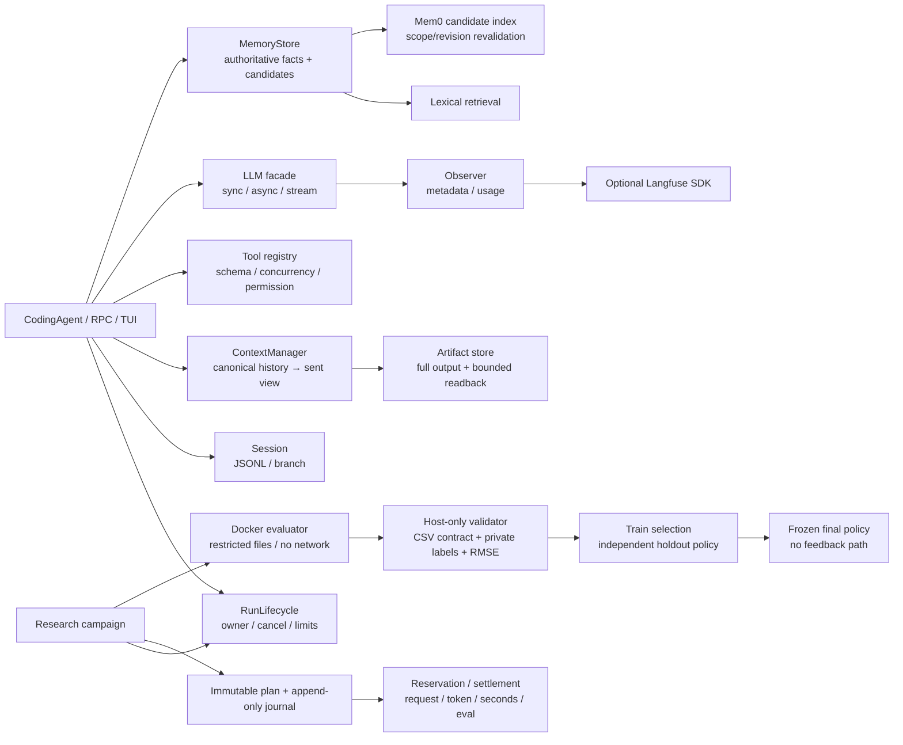

# my-agent-harness：面向代码实验的可观测 Agent Harness

更新日期：2026-11-15（Asia/Shanghai）。本文件是可用于简历、项目介绍和面试追问的最终事实版，基线为：

- Mem0：commit `f3e0d4d97ee9af8a7ad2a65f6726d93e971b5b9c`；
- Dream-RSI：commit `9d87bce6f7177850576516448d560bfd3853b57c`，结果文件为 `rsi-interview-results.md` 与 `rsi-compat7-summary.json`。

本文没有发起新的模型请求，也没有修改 RSI 源码、计划或账本。所有数字均来自已提交的真实实验产物；无法证明的用量和显著性结论保持 unavailable 或不声明。

项目一句话：在常规“模型调用 + 工具循环”之外，补上上下文投影、产物回读、长期记忆、宿主评分、持久预算、元数据观测和受控策略实验，并同时保留失败、未知用量与负结果。

## 可直接写简历的项目名

**my-agent-harness｜面向代码实验的可观测 Agent Harness**

技术栈可直接写：Python、异步调用、JSONL journal / checkpoint、Docker、BM25、Mem0、Qwen3-Embedding、Langfuse SDK、McNemar exact test。

## 可直接选用的简历 bullet

以下四条使用项目客观表述。投递前应把“参与范围”替换为本人真实完成的设计、实现、复现或验收动作；本项目是 AI 协作项目，不应把代理执行量改写为个人独立手写。

- 在 LoCoMo 30 道原题（dev 6、test 24）完成 `raw/facts × lexical/Mem0` 四臂配对评测：正确数分别为 **16/30（53.33%）、17/30（56.67%）、12/30（40.00%）、15/30（50.00%）**；`raw_mem0` 比 `raw_lexical` 多 1 题（3:2 discordant，exact McNemar `p=1.000`），`facts_mem0` 比 `facts_lexical` 多 3 题（4:1 discordant，`p=0.375`），因此未观察到统计显著的 Mem0 总体优势。
- 保留 12 题 LongMemEval 负结果并区分拒答与检索：none 4/12、lexical 11/12、Mem0 9/12；lexical 对 Mem0 为 2 胜、0 负、10 平，exact McNemar `p=0.500`，说明“接入语义检索 SDK”不等于取得记忆质量提升。
- 构建宿主评分与证据链：候选代码只能在受限容器内写 `predictions.csv`，标签留在宿主侧校验并重算 RMSE；LoCoMo v3 的 334 个请求全部 `ok`，120 个 answer 全有效，120 个 judge 中 108 个有效、12 个因输出长度按冻结规则计错；v3 provider total 为 **1,320,139 tokens**，连同保留的历史批次累计 **345 requests / 1,459,949 tokens**，保守账本成本 **$0.668615**，供应商实际账单 unavailable。
- 完成 Dream-RSI **7/8 个 test final 臂**：QSAR 的 fixed-reference、random、fixed-greedy final RMSE 均为 **1.432272**、相对均值基线均为 **1.0**；AutoMPG 四臂完整，random 的 **2.437353** 为完成臂中最低，但仅单 seed、单次运行；`trained-frozen` 是 fixed-reference `2/1` fallback，不能写成学习收益。

如果简历空间只保留两条，建议保留第一条“记忆四臂 + 不显著结论”和第四条“7/8 个 RSI final + 多臂边界”；它们最能体现可信实验设计、失败关闭和结果解释能力。

## 60 秒项目口述

“这个项目针对代码实验型 Agent：模型修改训练脚本，容器生成预测，宿主用私有标签重算指标。我把普通 Agent 的工具循环拆成可验证的运行边界：每个请求先预留预算、收到 provider usage 后结算；未知用量阻断重放；候选只能写一个预测文件；dev 反馈用于选择，final 不回流。上下文层把原始历史和发送视图分开，大输出保存在产物层并通过有界工具回读；记忆层保留本地事实权威，再评测 BM25 与 Mem0 候选检索。真实 LoCoMo 30 题中 Mem0 多答对 1 到 3 题，但 McNemar 不显著，而且 judge 有 12 次长度截断。RSI 完成了 7/8 个 final 臂：QSAR 三条完成臂都停在均值基线，AutoMPG 的 random 数值最低，但只有单 seed，frozen 又使用同参数 fallback。这个项目重点交付的是能力、成本、失败和不能下结论的地方。”

## 证据等级与主张边界

| 等级 | 本项目中的含义 | 可以写 | 不能写 |
|---|---|---|---|
| 代码已实现 | 有模块、契约和回归测试 | 已实现某接缝或失败关闭机制 | 已产生质量收益 |
| 本地已验证 | 使用真实生产模块、临时文件或假 provider 跑通 | 指定命令和环境下通过 | 真实模型或线上服务已验证 |
| 真实链路已接通 | 付费 provider、真实数据、journal 和终态都可核验 | 指定样本、模型和版本下完成了什么 | 跨模型、跨数据或生产 SLA |
| 科学结果 | 冻结数据/参数、配对或独立 final、失败也纳入 | 明确样本下的一致性、差异或不可识别 | 小样本不显著差异等于整体优劣 |

本版最诚实的三句结论是：

1. Mem0 在两个小样本记忆中都没有形成可被当前证据支持的总体优势；LoCoMo 的 12 个 `length` judge 进一步限制了四臂排序的纯检索解释。
2. RSI 的测试子集完成 7/8 个 final 臂。QSAR 已完成三臂结果相同；AutoMPG 四臂完整且 random 数值最低，但单 seed、单次运行、没有推断统计，训练收益仍不可识别。
3. 工程链路的可审计性高于“刷分”：真实 usage、失败、未知请求和不可比口径均被保留，reservation 不被冒充实际账单。

## 系统架构

核心依赖方向是“产品入口 → Runtime/Agent → Model、Tools、Session、Context、Memory”；评测代码调用公开产品接口，生产模块不反向依赖实验脚本。观测定为旁路：observer 或导出失败不得把模型结果改写成成功，也不自动重发已经可能计费的请求。

一次代码实验的数据流如下：

1. journal 在同一把锁内预留请求、token、时间与评估额度。
2. Agent 只能修改 `train.py`，并在固定镜像、无网络、只读根和单输出文件边界内运行。
3. 容器只写 `predictions.csv`；宿主检查字段、ID 和有限数值，再用 solver 不可见的标签重算指标。
4. 一个 round 只有在所有请求结算、工具调用配对、清理完成和 checkpoint 可核验后才提交。
5. optimizer 只消费训练 round；策略只有在独立 holdout 完整且严格改善时才晋升。
6. final 在冻结策略副本上执行，反馈不回到训练、记忆或 selection。

## 与普通 Agent Harness 的对比

这里比较的是设计能力，不是与某个开源 harness 的直接 A/B 成绩。当前仓库没有把该表转化为“优于普通 harness”的性能排名。

| 维度 | 普通最小实现 | 本项目实际增加的能力 | 可核验证据 |
|---|---|---|---|
| 执行循环 | `while model/tool`，取消主要靠进程退出 | 单 owner、轮次/时长边界、取消传播与 owned 资源清理 | 生命周期与取消回归；不能强制抢占不协作代码 |
| 上下文 | 直接把历史发给模型 | canonical history 与发送视图分离，动态快照和摘要覆盖可追踪 | 大输出夹具中发送视图从 120,019B 降至 7,041B，原文仍可回读 |
| 产物 | 把长工具输出留在 prompt | 产物存储 + 有界回读，验证证据可恢复 | 两路回读、越界和临时文件契约 |
| 预算与恢复 | 请求失败后盲目重试 | 请求前 reservation，终态 settlement；未知 usage fail-closed | JSONL journal、hash chain、checkpoint；不宣称外部副作用 exactly-once |
| 工具安全 | 所有工具直接执行 | schema、并发声明、依赖门控、副作用前授权 | 独立工具并发、依赖违规和拒绝路径 |
| 记忆 | 无记忆或直接向量 top-k | Markdown 事实权威；词法/Mem0 候选；scope/identity/revision 复验 | LongMemEval 12 题与 LoCoMo 30 题真实评测 |
| 观测 | 普通文本日志 | call/root/parent、purpose、usage、状态；Langfuse required raw owner | 本地 observer、真实 Langfuse 元数据回读、180 秒有界轮询 |
| 评分 | 信任候选 stdout / 自报分数 | 宿主私有标签、容器边界、限制文件输出 | Docker 八场景与真实代码实验 |
| 策略优化 | 看到反馈就继续试 | 冻结 plan、train/val/test 隔离、严格晋升、失败关闭 | RSI compat3–compat7 的 7/8 final、fallback 与 unknown STOP |

## 技术难点与解决过程

### 1. “记忆接上了”与“记忆更好了”是两个问题

初始风险是把 Mem0 SDK 成功返回候选，当成长期记忆质量提升。评测改成固定 history、chunk、top-8、6,000 字符上下文、answer model 和 judge 的四臂设计，并把本地来源事实作为权威数据；Mem0 候选命中后仍需按 scope、identity、revision 验证，正文从本地读取。LongMemEval 12 题和 LoCoMo 30 题都没有给出可宣称的总体增益。

这一步把可替换的检索候选与事实真值分开，也暴露了下一个瓶颈：session recall 高不代表答案证据进入上下文。LoCoMo 的 `facts_mem0` session recall@8 达到 **0.9140**、MRR 达到 **0.8689**，但 multi-hop 只答对 **1/10**。

### 2. 答案正确率被 judge 终止契约混入

LoCoMo v3 的 120 个 answer 全部有效，但 120 个 judge 中 12 个达到 512-token 上限。预注册规则规定 `length` 计错，且失败后不自动重试或补判，以免看到结果后再改协议。因此用于主表的正确数包含 judge 契约失败；valid-only 正确率只能作为敏感性分析，不能替代冻结主结果。

### 3. 规划口径与实际文档拆分不一致

计划按 92 个唯一 session 估算 332 次调用，但为满足 6,000 字符上限，两个超长 session 各拆成两份文档，实际抽取 94 次，v3 总请求为 334。报告以 ledger 为准，没有覆盖冻结 plan，也没有把 332 改成“实测值”。

### 4. 云端观测可见性存在时序

v2 的单次回读没有及时命中 trace；后续只读复核能精确匹配两条旧 trace，说明远端可见性需要等待，但旧 STOP 和缺失答案不回写。v3 recovery 改成 180 秒有界指数轮询，每 trace 只接受一个精确匹配的 observation；首两 trace 分别查询 1/4 次，在 13.4118 秒内通过，额外模型请求为 0。

### 5. 停在同一完成边界，失败不能自动重放

v3 初跑第 8 笔抽取在 8,192 completion tokens 处 `length` 且正文为空，原 **8 requests / 102,453 tokens** 原样保留。恢复批次只提高抽取上限和请求窗口，使用新 campaign / namespace，不重放旧 call identity。最终全部模型调用和 conversation 已终态后，重复写 `owner-close.json` 触发 `FileExistsError`；STOP 被保留，报告标记“全部终态后停止”，停止后新增模型请求为 0。

### 6. RSI 的可识别性来自实验设计，不来自 SDK 跑通

RSI 把候选限制为白名单探索参数，固定 runner、镜像、评分器和 final 隔离；random 只改变预注册探索顺序，fixed-reference 与训练臂共用 scheduler。Wine holdout 在第二轮出现 provider unknown，optimizer 没有运行，`promoted=false`；因此所有 `trained-frozen` 结果都显式使用 fixed-reference 的 `2/1` 参数，并记录 `learning_effect=unidentifiable`。不能把 SDK 返回 active policy 或参数相同的结果写成模型学会提升。

### 7. 时间边界会停止在途请求

QSAR frozen 在 1,200 秒边界出现 provider usage unknown：12 个请求中 11 个正常结算，最后 1 个没有可靠 usage，campaign 没有 final。运行器保留 journal 后 STOP，没有模型重试，也没有用 reservation 估算实际 token。这个细节点区分了两件事：安全状态已经停止，不等于成本或科学结果已经完整。

## 实验 1：LongMemEval 12 题三臂

固定新 12 题，每类 2 题，seed 24；none、lexical、Mem0 共用匿名 chunk、top-8 和 6,000 字符上下文。Mem0 使用 `infer=False` 的历史块索引，验证受控检索，不验证自动事实抽取、更新和巩固。

| 臂 | 正确 / 12 | 准确率 | 95% Wilson 区间 | 说明 |
|---|---:|---:|---:|---|
| none | 4 | 33.33% | 13.81%–60.94% | 不含记忆 |
| lexical | 11 | 91.67% | 64.61%–98.51% | BM25 对照 |
| Mem0 | 9 | 75.00% | 46.77%–91.11% | 本地固定 embedding 候选 |

lexical 对 Mem0 的配对结果为 2 胜、0 负、10 平；exact McNemar `p=0.500`。36 次检索均有效并完成关闭，36 answer + 36 judge 共 72 次真实请求、**41,852 actual tokens** 全部结算，`retry=0`，所有 `finish_reason=stop`。四道拒答题三臂均为 4/4；非拒答八题分别为 0/8、7/8、5/8。旧 session recall 分母只有 8 道带标签的普通题，不把它写成 12 题 recall 或答案证据块 recall。

## 实验 2：LoCoMo 30 题四臂

数据固定在 `snap-research/locomo` 的 commit `3eb6f2c585f5e1699204e3c3bdf7adc5c28cb376`；选取 dev 6、test 24，共 92 个唯一 session，实际产生 94 个 extract documents。词法使用 BM25，语义臂使用固定 Qwen3-Embedding 0.6B revision `97b0c614be4d77ee51c0cef4e5f07c00f9eb65b3`，top-8、6,000 字符上下文，answer temperature 0，judge 冻结且只接受 JSON boolean。

| 臂 | 正确 / 30 | 准确率 | 95% Wilson 区间 | valid judge | session recall@8 | session MRR | multi-hop | cross-session |
|---|---:|---:|---:|---:|---:|---:|---:|---:|
| raw_lexical | 16 | 53.33% | 36.14%–69.77% | 30/30 | 0.8299 | 0.7837 | 2/10 | 2/10 |
| raw_mem0 | 17 | 56.67% | 39.20%–72.62% | 28/30 | 0.8125 | 0.7722 | 3/10 | 3/10 |
| facts_lexical | 12 | 40.00% | 24.59%–57.68% | 25/30 | 0.8913 | 0.7678 | 0/10 | 0/10 |
| facts_mem0 | 15 | 50.00% | 33.15%–66.85% | 25/30 | 0.9140 | 0.8689 | 1/10 | 1/10 |

主表的 30 题分母包含 12 个 judge `length`，并按冻结规则计错。valid-only 正确率分别为 **53.33%、60.71%、48.00%、60.00%**，只用于解释 judge 敏感性。

表中的 95% Wilson 区间由当前 safe rows 的二项正确数重新计算，仅描述每个臂的边际不确定性；它不替代配对 McNemar 检验，也不处理题目聚类或多次比较。

### raw / facts × lexical / Mem0 消融

| 对照 | left only | right only | both correct | both wrong | 差值（left − right） | exact McNemar p |
|---|---:|---:|---:|---:|---:|---:|
| `raw_lexical` vs `raw_mem0` | 2 | 3 | 14 | 11 | -1 | 1.000 |
| `facts_lexical` vs `facts_mem0` | 1 | 4 | 11 | 14 | -3 | 0.375 |
| `raw_lexical` vs `facts_lexical` | 5 | 1 | 11 | 13 | +4 | 0.219 |
| `raw_mem0` vs `facts_mem0` | 4 | 2 | 13 | 11 | +2 | 0.688 |

从 Mem0 视角看，raw 的 discordant 为 **3:2**，facts 为 **4:1**，但两组 exact McNemar 分别为 1.000 和 0.375。p 值为探索性，没有多重比较校正。这批结果支持“继续调查哪些 case、哪种记忆粒度会丢信息”，不支持“Mem0 全面优于词法”或“facts 全面优于 raw”。

### dev / test 边界

dev 的 raw Mem0 为 5/6，但没有据此换题或重跑；test 按冻结的 24 题全部执行。test 中 `facts_mem0` 为 13/24，是四臂最高；`raw_lexical` 与 `raw_mem0` 各 12/24，`facts_lexical` 为 11/24。dev 只用于桥接和协议检查，不参与 winner 或 final 选择。

## 实验 3：Dream-RSI 两数据集、四臂测试

RSI 预注册 QSAR（546 行）和 AutoMPG（392 行）各四条 test/final 臂，任务内按 60/20/20 切分，固定 DeepSeek V4.1 Flash、无网络 Docker、`retry=0` 和每臂 24 requests / 400,000 tokens / 1,200 秒 / 5 evaluations 上限。fixed-reference 使用 width 2、refine 1；random 保持相同参数，只改变 seed 20261114 的探索顺序；fixed-greedy 使用 width 1、refine 0；trained-frozen 依赖独立的 Airfoil train → Wine holdout 晋升。

最终完成 **7/8 个 test final 臂**。下表保留完成臂和失败臂，不把缺失值写成 0。

| 数据集 | 臂 | round dev RMSE | final RMSE | final / 均值基线 | 状态 | requests | provider tokens | evals | active sec |
|---|---|---:|---:|---:|---|---:|---:|---:|---:|
| QSAR | fixed-reference | 1.759991 | **1.432272** | 1.0000 | final 完成 | 12 | 136655 | 5 | 1154.452 |
| QSAR | random | 1.759991 | **1.432272** | 1.0000 | final 完成 | 12 | 166542 | 5 | 1154.572 |
| QSAR | trained-frozen | — | — | — | **无 final；provider usage unknown** | 12 dispatched | 149017 known | 3 | 1200.048 |
| QSAR | fixed-greedy | 1.759991 | **1.432272** | 1.0000 | final 完成 | 4 | 26650 | 3 | 241.563 |
| AutoMPG | fixed-reference | 2.574058 | **2.515738** | 0.3516 | final 完成 | 12 | 141057 | 5 | 979.142 |
| AutoMPG | random | 2.778874 | **2.437353** | 0.3407 | final 完成 | 12 | 137147 | 5 | 1151.366 |
| AutoMPG | trained-frozen（fixed fallback） | 2.724798 | **2.495291** | 0.3488 | final 完成；不是训练收益 | 12 | 128325 | 5 | 1067.644 |
| AutoMPG | fixed-greedy | 8.041614 | **7.154405** | 1.0000 | final 完成 | 4 | 23482 | 3 | 207.367 |

### QSAR 结果

QSAR 的三条完成臂 fixed-reference、random、fixed-greedy 都保留原始均值 baseline，final RMSE 均为 **1.432272**，相对各自均值基线均为 **1.0**。因此在这一个 test split、一个 seed 上，没有观察到三种完成策略相对基线或其他完成策略的改善。

QSAR trained-frozen 在 fallback 到 `2/1` 参数后运行，但在 1,200 秒边界出现 provider usage unknown；12 个请求中 11 个结算、最后 1 个未知，完成 3 次 evaluation，没有 round commit 或 final。表中的 149,017 只是已知 token，不能把未知调用写成 0。

### AutoMPG 结果

AutoMPG 四个原始臂全部完成。fixed-reference、random、trained-frozen fallback 的 final RMSE 分别为 **2.515738、2.437353、2.495291**，都明显低于自身均值基线，ratio 分别为 **0.3516、0.3407、0.3488**。random 是完成臂中数值最低者，比 fixed 低 **0.078385**，但实验只有一个 seed、每臂一次 final，没有重复采样、置信区间或显著性检验，因此只能写“本次数值最低”。

fixed-greedy 的 single candidate 无效，final 保留均值 baseline，RMSE **7.154405**、ratio **1.0**。`trained-frozen` 与 fixed 使用相同参数；它与 fixed 的差异只能解释为运行与采样波动，不能解释为训练或策略学习收益。

### 训练、晋升与故障边界

- Airfoil：两轮来自旧 v3 已提交历史，只导入、不重跑。
- Yacht round0：旧 baseline，RMSE `16.662447`；compat2 已结算 12 requests / 130458 tokens / 3 evals。
- Yacht round1：compat3 新跑 12 requests / 128344 tokens / 3 evals / 966s；两个候选 known-invalid，保留 baseline。
- Wine：compat3 新跑 10 requests / 3 evals / 1200.05s；request 10 超时，112662 known tokens，另有 27818 reservation。usage unknown 后立即停止，round 未提交，旧 attempt 未重放。
- optimizer：因没有完整 Wine holdout trace，显式不运行；`promoted=false`。
- 全部 `trained-frozen` 结果使用 fixed-reference `2/1` fallback，`learning_effect=unidentifiable`。

## 失败实验与结论

| 阶段 | 真实现象 | 保留的结论 |
|---|---|---|
| LongMemEval 12 题 | none 4、lexical 11、Mem0 9 | Mem0 未优于词法；拒答与普通题分开解释 |
| LoCoMo v1 | 1 request / 11,351 tokens，2,048-token length stop | 初始抽取预算不足；原始 STOP 保留 |
| LoCoMo v2 | 2 requests / 26,006 tokens，一次性云端回读未命中 | 旧结果不恢复；后续只读复核只解释可见性时序 |
| LoCoMo v3 initial | 8 requests / 102,453 tokens，8,192-token reasoning-only length stop | 以新 recovery identity 继续；旧调用不重放 |
| LoCoMo v3 recovery | 334 requests 全 ok；12 个 judge length；全部终态后 owner-close 重名异常 | 成绩有效但 judge 解释力受损；停止后 0 请求 |
| RSI compat3/4 | 训练/验证完整性不足，optimizer 未晋升；后续配置 STOP | 保留历史用量与 STOP；禁止强制提升 |
| RSI Wine | request 10 provider timeout；usage unknown；无完整 round | optimizer 不运行；不能用不完整 holdout 训练 |
| RSI QSAR frozen | 1,200 秒边界；最后一个请求 unknown；无 final | 7/8 final；训练贡献仍不可识别 |
| RSI 总账 | 3 个 unknown requests；actual token 与 USD unavailable | reservation 和 known token 不能冒充实际账单 |

这些失败不是被删除的“坏数据”。它们定义了下一轮实验应改变的最小变量：提高 judge 输出上限、先做 valid-judge gate、冻结实际 extract document 数、增加题目数量、预注册时间上限和取消后的 usage 处理，并在完整 holdout 可用后重新检验 frozen 策略。

## 成本、用量与可靠性

### LoCoMo v3

| 阶段 | requests | prompt | completion | cache read | provider total | 延迟和（秒） |
|---|---:|---:|---:|---:|---:|---:|
| extraction | 94 | 210,593 | 183,697 | 727,808 | 1,122,098 | 2,114.084 |
| answer | 120 | 133,753 | 18,198 | 256 | 152,207 | 513.496 |
| judge | 120 | 26,559 | 19,275 | 0 | 45,834 | 526.631 |
| **v3 total** | **334** | **370,905** | **221,170** | **728,064** | **1,320,139** | **3,154.210** |

v3 的 334 个请求全部终态为 `ok`，unknown / in-flight 均为 0，answer 120/120 有效，judge 108 有效、12 个 length 计错。v3 conservative ledger cost 为 `$0.595242`。连同保留的 v1、v2、v3 初跑，累计 **345 requests / provider total 1,459,949 / conservative cost $0.668615**；provider total 包含 cache-read tokens，不能用 prompt + completion 代替，供应商实际账单仍为 unavailable。

### LongMemEval

36 answer + 36 judge，共 **72 requests / 41,852 actual tokens**；每个请求都有终态，`held=0`、`unknown=false`、`retry=0`。供应商金额未核验，不能使用兼容代理的 USD 上限当作实际费用。

### Dream-RSI

最终总账为 **151 requests / 1,798,894 accounting units / 1,655,475 known settled tokens / 56 evaluations / 12,776.24 active seconds**。其中有 **3 个 unknown requests**，reservation occupancy 为 **143,419**；unknown 的实际 token 和 USD 均为 unavailable，accounting units 不能当作实际账单总额。

所有 compat3、compat4、compat5、compat6、compat7 模型调用都走 required Langfuse raw owner；元数据回读窗口为 **180 秒**，只读观测 API 使用有界指数退避并只请求元数据。模型请求 retry 固定为 **0**，任何 provider unknown 都停止后续派发；历史请求没有重放。compat2 的 14 个调用在 STOP 后只读回读全部匹配，本批没有再上传历史内容。

## 面试追问与参考答案

### 1. 这个项目和普通 Agent harness 最大的区别是什么？

普通 harness 通常先解决“模型能调用工具并继续”。这里进一步处理长任务里更容易失控的四类状态：上下文证据、调用预算、进程完成边界和评分权限。具体实现包括 canonical history 与发送视图分离、产物有界回读、reservation/settlement journal、宿主私有标签评分和 Langfuse 旁路观测。它不是从零替代所有 Agent 框架，而是在现有 CodingAgent 上补可验证接缝。

### 2. 为什么 Mem0 “有数值提升”却不写“提升”？

LoCoMo 中 `raw_mem0` 比 `raw_lexical` 多 1 题，discordant 为 **3:2**，exact McNemar `p=1.000`；`facts_mem0` 比 `facts_lexical` 多 3 题，discordant 为 **4:1**，`p=0.375`。30 题小样本、边际 Wilson 区间重叠、没有多重比较校正，另有 12 个 judge 受 512-token 上限影响。因此只能说“方向值得复查”，不能写总体改善。

### 3. 为什么 `facts_mem0` 的 session recall 和 MRR 最高，正确率却不高？

session recall 衡量相关来源 session 是否进入 top-8，不等于答案所需支持事实一定被保留或正确组合。facts 路径先抽取、再检索，可能丢失跨 session 的组合条件；`facts_mem0` 的 recall/MRR 虽为 0.9140 / 0.8689，但 10 道 multi-hop 只答对 1 题。下一轮需要分别标注 answer-bearing chunk、事实充分性和 multi-hop 关系覆盖。

### 4. 12 个 judge 达到长度上限，为什么不全部重判？

因为 512-token 上限和“length 计错”在运行前冻结。看到结果后只重判失败单元会改变 estimand，并可能引入选择偏差。当前结果按冻结规则交付，valid-only 作为敏感性分析。下一批应先验证 judge 输出格式和停止原因，再执行正式评测。

### 5. 为什么要区分 dev 和 test？

dev 用于桥接、协议检查和当前学习/选择；test final 是一次性独立评估。LoCoMo dev 的 raw Mem0 为 5/6，但没有据此换题或重跑 test。RSI 的 final 反馈也不能回到 selection、memory 或 optimizer。

### 6. 为什么候选程序不能自己返回 RMSE？

容器中的候选由模型生成，不能被视为可信评分器。它只获得特征和训练数据边界，输出受限预测 CSV；宿主验证 schema、ID、行数和数值有限性，再用 solver 不可见的标签重算。即使这样，共享内核和 Docker daemon 仍是需要信任的基础层。

### 7. journal 能保证 exactly-once 吗？

不能。journal 能记录 reservation、settlement 和 round checkpoint，在明确的空档安全边界验证后续跑；如果请求已发出但 usage 未知，只能 fail-closed，不能证明外部副作用没有发生。因此项目不宣称 exactly-once。

### 8. RSI 是什么？为什么不是“模型自我进化”？

这里优化的是白名单探索参数，如 width 和 refine，不训练模型权重，也不让 Agent 任意重写 runner。train 轨迹提供候选，holdout 决定是否晋升，final 独立执行。SDK replay 成功只证明闭环可运行，不能自动证明策略更好。

### 9. QSAR 的四个 RSI 臂分别说明什么？

QSAR fixed-reference、random、fixed-greedy 都完成 final，RMSE 都为 **1.432272**，相对均值基线都为 **1.0**；这意味着在这一个 seed 和 split 上，三种完成策略都没有产生可观测改善。trained-frozen 因 Wine holdout 不完整而回退到同参数，随后在 1,200 秒边界遇到 provider unknown，没有 final。不能把缺失写成 0，也不能宣称 fixed/random/greedy 在所有数据上等价。

### 10. AutoMPG 为什么不能写成“random 显著更好”？

AutoMPG 四臂完成：fixed 2.515738、random 2.437353、frozen fallback 2.495291、greedy 7.154405。random 在本次数值最低，但只有一个 seed、每臂一次 final，没有配对重复或显著性检验；frozen fallback 又不能代表学习策略。因此可以说“本次 numeric ranking”，不能说显著优势或泛化收益。

### 11. trained-frozen 为什么不能写训练收益？

Wine holdout 在 request 10 出现 provider unknown，round 未提交；optimizer 没有运行，`promoted=false`。运行器显式回退到 fixed-reference 的 `2/1` 参数。即使某些 dev candidate RMSE 比 seed baseline 好，也没有完整晋升轨迹和独立 learned policy，训练与 reference 不可区分。

### 12. RSI 的 STOP、unknown 与成本边界是什么？

QSAR frozen 在 1,200 秒边界没有返回可靠 usage，运行器保留 journal 后 STOP；模型请求 retry 为 0，旧调用没有重放。最终总账有 3 个 unknown requests。已知 settled tokens 为 1,655,475，但 unknown 的实际 token 与 USD 都 unavailable；reservation occupancy 143,419 不能冒充账单。

### 13. 下一次最值得做的实验是什么？

先固定更高 judge 输出预算，并用预运行 gate 验证全部 judge 合法；用同一批 LoCoMo 题做配对复核，扩大样本并按题型分层。RSI 需要先补齐 Wine holdout 和在途取消后的 usage 契约，再做多 seed、重复 final 和推断统计，确认 AutoMPG 的 numeric ranking 是否能复现。当前 7/8 结果足够支持工程复盘，不支持普遍性能主张。

### 14. 你个人负责哪部分？

这一段必须在投递前按真实参与替换。建议按可演示证据选择：参与了实验协议/接缝设计、实现了某一模块、完成了某次复现与验收，或只负责材料整理。至少要能脱离文档解释一条调用链，例如“预测 CSV → 宿主校验/标签 → journal settlement”，并如实说明 AI 协作范围。

## 可复现证据入口

- LoCoMo v3 完整报告：[REPORT.md](../results/locomo-memory-v3-20261115/REPORT.md)
- LoCoMo 机器汇总：[summary.json](../results/locomo-memory-v3-20261115/summary.json)
- LoCoMo 用量：[usage.json](../results/locomo-memory-v3-20261115/usage.json)
- LoCoMo finalization：[finalization.json](../results/locomo-memory-v3-20261115/finalization.json)
- LongMemEval 报告：[effect-v1-sol2.md](effect-v1-sol2.md)
- RSI 面试结果：[rsi-interview-results.md](../results/research-effect-20261114/rsi-interview-results.md)
- RSI 机器汇总：[rsi-compat7-summary.json](../results/research-effect-20261114/rsi-compat7-summary.json)
- 可交互看板：[mem0-rsi-effects.canvas.tsx](C:/Users/MLL/.cursor/projects/c-Users-MLL-Desktop-my-agent-harness/canvases/mem0-rsi-effects.canvas.tsx)

## 不能写的更强结论

- 不写“Mem0 提升长期记忆正确率 X%”：主要对照均不显著，judge 也有长度截断。
- 不写“facts 全面优于 raw”：部分数值方向存在，但没有显著性或跨数据一致性。
- 不写“RSI 提升代码实验能力”：QSAR 已完成三臂都等于均值基线，AutoMPG 只有一个 seed，训练策略未晋升。
- 不写“AutoMPG random 显著优于 fixed”：这个说法没有重复运行或推断统计支持。
- 不写“trained-frozen 已学习”：实际是 fixed-reference fallback，Wine holdout 不完整，optimizer 未运行。
- 不写“云端观测完整回放”：已验证的是带 session/metadata 的元数据读回；旧请求没有回填或重放。
- 不写“生产级高可用 / exactly-once”：journal 和 checkpoint 有明确边界，外部副作用与同步代码无法保证强制回滚。
