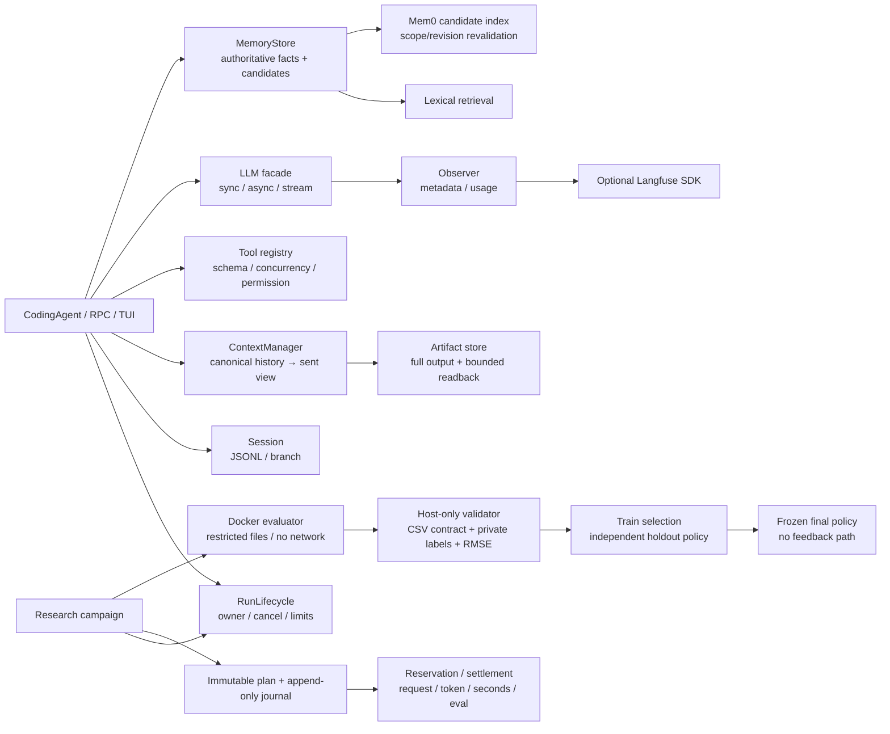

# my-agent-harness：面向代码实验的可观测 Agent Harness

更新日期：2026-11-15（Asia/Shanghai）。本文件是可直接用于简历、项目介绍和面试追问的第一版材料，事实基线为 `f3e0d4d97ee9af8a7ad2a65f6726d93e971b5b9c` 及之后的本机 RSI compat5 证据。本文没有发起新的付费模型请求，也没有修改 RSI 源码、计划或原始账本。

项目一句话：在常规“模型调用 + 工具循环”之外，补上上下文投影、产物回读、长期记忆、宿主评分、持久预算、元数据观测和受控策略实验，并同时保留失败、未知用量与负结果。

## 可直接写简历的项目名

**my-agent-harness｜面向代码实验的可观测 Agent Harness**

技术栈可直接写：Python、异步调用、JSONL journal / checkpoint、Docker、BM25、Mem0、Qwen3-Embedding、Langfuse SDK、McNemar exact test。

## 可直接选用的简历 bullet

以下四条使用项目客观表述。投递前应把“参与范围”替换为本人真实完成的设计、实现、复现或验收动作；本项目是 AI 协作项目，不应把代理执行量改写为个人独立手写。

- 在 LoCoMo 30 道原题（dev 6、test 24）完成 `raw/facts × lexical/Mem0` 四臂配对评测：四臂正确数为 16/17/12/15；`facts_mem0` 比 `facts_lexical` 多 3 题，但 exact McNemar `p=0.375`，`raw_mem0` 比 `raw_lexical` 多 1 题且 `p=1.000`，因此结论是 Mem0 未表现出统计显著的总体优势。
- 保留 12 题 LongMemEval 负结果并区分拒答与检索：none 4/12、lexical 11/12、Mem0 9/12；lexical 对 Mem0 为 2 胜、0 负、10 平，说明“接入语义检索 SDK”不等于取得记忆质量提升。
- 构建宿主评分与证据链：候选代码只能在受限容器内写 `predictions.csv`，标签留在宿主侧校验并重算 RMSE；LoCoMo v3 的 334 个请求全部记账结算，120 个 answer 全成功，120 个 judge 中 108 个有效、12 个因输出长度按预注册规则计错，v3 provider total 为 1,320,139 tokens。
- 完成 QSAR 上 RSI `fixed-reference` 与随机探索顺序的同预算 final，两臂均为 RMSE 1.432272、utility 0.411138，随机顺序没有改善；`trained-frozen` 因 Wine holdout 不完整而显式回退到同参数 reference，运行到 1,200 秒边界停止且未产生 final，因此不宣称训练增益。

如果简历空间只保留两条，建议保留第一条“记忆四臂 + 不显著结论”和第三条“宿主评分/预算/可观测证据”；它们最能体现 Agent 应用工程和可信评测能力。

## 60 秒项目口述

“这个项目针对代码实验型 Agent：模型修改训练脚本，容器生成预测，宿主用私有标签重算指标。我把普通 Agent 的工具循环拆成可验证的运行边界：每个请求先预留预算、收到 provider usage 后结算；未知用量阻断重放；候选只能写一个预测文件；dev 反馈用于选择，final 不回流。上下文层把原始历史和发送视图分开，大输出保存在产物层并通过有界工具回读；记忆层保留本地事实权威，再评测 BM25 与 Mem0 候选检索。真实 LoCoMo 30 题中 Mem0 有 1 到 3 道题的数值增益，但 McNemar 不显著，而且 judge 有 12 次长度截断；QSAR 的 RSI 固定与随机臂 final 完全相同，训练臂又因 holdout 不完整回退。这个项目的重点是把能力、成本、失败和不能下结论的地方一起交付。”

## 证据等级与主张边界

| 等级 | 本项目中的含义 | 可以写 | 不能写 |
|---|---|---|---|
| 代码已实现 | 有模块、契约和回归测试 | 已实现某接缝或失败关闭机制 | 已产生质量收益 |
| 本地已验证 | 使用真实生产模块、临时文件或假 provider 跑通 | 指定命令和环境下通过 | 真实模型或线上服务已验证 |
| 真实链路已接通 | 付费 provider、真实数据、journal 和终态都可核验 | 指定样本、模型和版本下完成了什么 | 跨模型、跨数据或生产 SLA |
| 科学结果 | 冻结数据/参数、配对或独立 final、失败也纳入 | 明确样本下的一致性或差异 | 小样本不显著差异等于整体优劣 |

本版最诚实的三句结论是：

1. Mem0 在这两个小样本记忆中都没有形成可被当前证据支持的总体优势。
2. RSI 已完成 QSAR 的 fixed/random 两次 final，两者完全相同；训练增益不可识别，其他六臂没有完成。
3. 工程链路的可审计性高于“刷分”：真实 usage、失败、未知请求和不可比口径均被保留。

## 系统架构

核心依赖方向是“产品入口 → Runtime/Agent → Model、Tools、Session、Context、Memory”；评测代码调用公开产品接口，生产模块不反向依赖实验脚本。观测定为旁路：observer 或导出失败不得把模型结果改写成成功，也不自动重发已经可能计费的请求。

一次代码实验的数据流如下：

1. journal 在同一把锁内预留请求、token、时间与评估额度。
2. Agent 只能修改 `train.py`，并在固定镜像、无网络、只读根和单输出文件边界内运行。
3. 容器只写 `predictions.csv`；宿主检查字段、ID 和有限数值，再用 solver 不可见的标签重算指标。
4. 一个 round 只有在所有请求结算、工具调用配对、清理完成和 checkpoint 可核验后才提交。
5. optimizer 只消费训练 round；策略只有在独立 holdout 完整且严格改善时才晋升。
6. final 在冻结策略副本上执行，反馈不回到训练、记忆或 selection。

## 与普通 Agent Harness 的对比

这里比较的是设计能力，不是与某个开源 harness 的直接 A/B 成绩。当前仓库没有把该表转化为“优于普通 harness”的性能排名。

| 维度 | 普通最小实现 | 本项目实际增加的能力 | 可核验证据 |
|---|---|---|---|
| 执行循环 | `while model/tool`，取消主要靠进程退出 | 单 owner、轮次/时长边界、取消传播与 owned 资源清理 | 生命周期与取消回归；不能强制抢占不协作代码 |
| 上下文 | 直接把历史发给模型 | canonical history 与发送视图分离，动态快照和摘要覆盖可追踪 | 大输出夹具中发送视图从 120,019B 降至 7,041B，原文仍可回读 |
| 产物 | 把长工具输出留在 prompt | 产物存储 + 有界回读，验证证据可恢复 | 两路回读、越界和临时文件契约 |
| 预算与恢复 | 请求失败后盲目重试 | 请求前 reservation，终态 settlement；未知 usage fail-closed | JSONL journal、hash chain、checkpoint；不宣称外部副作用 exactly-once |
| 工具安全 | 所有工具直接执行 | schema、并发声明、依赖门控、副作用前授权 | 独立工具并发、依赖违规和拒绝路径 |
| 记忆 | 无记忆或直接向量 top-k | Markdown 事实权威；词法/Mem0 候选；scope/identity/revision 复验 | LongMemEval 12 题与 LoCoMo 30 题真实评测 |
| 观测 | 普通文本日志 | call/root/parent、purpose、usage、状态；默认元数据，旁路失败 | 本地 observer、真实 Langfuse 单 generation 读回 |
| 评分 | 信任候选 stdout / 自报分数 | 宿主私有标签、容器边界、限制文件输出 | Docker 八场景与真实代码实验 |
| 策略优化 | 看到反馈就继续试 | 冻结 plan、train/val/test 隔离、严格晋升、失败关闭 | RSI compat3–compat5 的真实 final、fallback 与 STOP |

## 技术难点与解决过程

### 1. “记忆接上了”与“记忆更好了”是两个问题

初始风险是把 Mem0 SDK 成功返回候选，当成长期记忆质量提升。评测改成固定 history、chunk、top-8、6000 字符上下文、answer model 和 judge 的四臂设计，并把本地来源事实作为权威数据；Mem0 候选命中后仍需按 scope、identity、revision 验证，正文从本地读取。LongMemEval 12 题和 LoCoMo 30 题都没有给出可宣称的总体增益。

这一步把可替换的检索候选与事实真值分开，也暴露了下一个瓶颈：session recall 高不代表答案证据进入上下文。LoCoMo 的 `facts_mem0` session recall@8 达到 0.9140、MRR 达到 0.8689，但 multi-hop 只答对 1/10。

### 2. 答案正确率被 judge 终止契约混入

LoCoMo v3 的 answer 全部有效，但 120 个 judge 中 12 个达到 512-token 上限。预注册规则规定 `length` 计错，且失败后不自动重试或补判，以免看到结果后再改协议。因此用于主表的正确数包含 judge 契约失败；valid-only 正确率只能作为敏感性分析，不能替代冻结主结果。

### 3. 规划口径与实际文档拆分不一致

计划按 92 个唯一 session 估算 332 次调用，但为满足 6,000 字符上限，两个超长 session 各拆成两份文档，实际抽取 94 次，v3 总请求为 334。报告以 ledger 为准，没有覆盖冻结 plan，也没有把 332 改成“实测值”。

### 4. 云端观测可见性存在时序

v2 的单次回读没有及时命中 trace；后续只读复核能精确匹配两条旧 trace，说明远端可见性需要等待，但旧 STOP 和缺失答案不回写。v3 recovery 改成 180 秒有界指数轮询，每 trace 只接受一个精确匹配的 observation；首两 trace 分别查询 1/4 次，在 13.4118 秒内通过，额外模型请求为 0。

### 5. 停在同一完成边界，失败不能自动重放

v3 初跑第 8 笔抽取在 8,192 completion tokens 处 `length` 且正文为空，原 8 requests / 102,453 tokens 原样保留。恢复批次只提高抽取上限和请求窗口，使用新 campaign / namespace，不重放旧 call identity。最终全部模型调用和 conversation 已终态后，重复写 `owner-close.json` 触发 `FileExistsError`；STOP 被保留，报告标记“全部终态后停止”，停止后新增模型请求为 0。

### 6. RSI 的可识别性来自实验设计，不来自 SDK 跑通

RSI 把候选限制为 allowlist 参数，固定 runner、镜像、评分器和 final 隔离；random 只改变预注册探索顺序，fixed-reference 与训练臂共用 scheduler。Wine holdout 未形成完整可晋升记录，因此 `trained-frozen` 明确回退到参数相同的 reference，并记录 `learning_effect=unidentifiable`。不能把 SDK 返回 active policy 或参数相同的结果写成模型学会提升。

### 7. 时间边界会停止在途请求

compat5 的 QSAR frozen 运行在第 12 个 request 时到达 1,200 秒边界；该调用记录为 `cancelled`、usage 为 `null`，前 11 个调用正常 `ok`。运行器保留 journal 后 STOP，没有重试，也没有继续后面六个 campaign。这个细节比只写“达到时间上限”更严格：已知 token 可以相加，未知调用不能编造，成本和 science outcome 均标记不完整。

## 实验 1：LongMemEval 12 题三臂

固定新 12 题，每类 2 题，seed 24；none、lexical、Mem0 共用匿名 chunk、top-8 和 6000 字符上下文。Mem0 使用 `infer=False` 的历史块索引，验证受控检索，不验证自动事实抽取、更新和巩固。

| 臂 | 正确 / 12 | 准确率 | 95% Wilson 区间 | 说明 |
|---|---:|---:|---:|---|
| none | 4 | 33.33% | 13.81%–60.94% | 不含记忆 |
| lexical | 11 | 91.67% | 64.61%–98.51% | BM25 对照 |
| Mem0 | 9 | 75.00% | 46.77%–91.11% | 本地固定 embedding 候选 |

lexical 对 Mem0 的配对结果为 2 胜、0 负、10 平；exact McNemar `p=0.500`。36 次检索均有效并完成关闭，36 answer + 36 judge 共 72 次真实请求、41,852 actual tokens 全部结算，`retry=0`，所有 `finish_reason=stop`。四道拒答题三臂均为 4/4；非拒答八题分别为 0/8、7/8、5/8。旧 session recall 分母只有 8 道带标签的普通题，不把它写成 12 题 recall 或答案证据块 recall。

## 实验 2：LoCoMo 30 题四臂

数据固定在 `snap-research/locomo` 的 commit `3eb6f2c585f5e1699204e3c3bdf7adc5c28cb376`；选取 dev 6、test 24，共 92 个唯一 session，实际产生 94 个 extract documents。词法使用 BM25，语义臂使用固定 Qwen3-Embedding 0.6B revision `97b0c614be4d77ee51c0cef4e5f07c00f9eb65b3`，top-8、6000 字符上下文，answer temperature 0，judge 冻结且只接受 JSON boolean。

| 臂 | 正确 / 30 | 准确率 | 95% Wilson 区间 | valid judge | session recall@8 | session MRR | multi-hop | cross-session |
|---|---:|---:|---:|---:|---:|---:|---:|---:|
| raw_lexical | 16 | 53.33% | 36.14%–69.77% | 30/30 | 0.8299 | 0.7837 | 2/10 | 2/10 |
| raw_mem0 | 17 | 56.67% | 39.20%–72.62% | 28/30 | 0.8125 | 0.7722 | 3/10 | 3/10 |
| facts_lexical | 12 | 40.00% | 24.59%–57.68% | 25/30 | 0.8913 | 0.7678 | 0/10 | 0/10 |
| facts_mem0 | 15 | 50.00% | 33.15%–66.85% | 25/30 | 0.9140 | 0.8689 | 1/10 | 1/10 |

主表的 30 题分母包含 12 个 judge `length`，并按冻结规则计错。valid-only 正确率分别为 53.33%、60.71%、48.00%、60.00%，只用于解释 judge 敏感性。

表中的 95% Wilson 区间由当前 safe rows 的二项正确数重新计算，仅描述每个臂的边际不确定性；它不替代配对 McNemar 检验，也不处理题目聚类或多次比较。

### raw / facts × lexical / Mem0 消融

| 对照 | left only | right only | both correct | both wrong | 差值（left − right） | exact McNemar p |
|---|---:|---:|---:|---:|---:|---:|
| `raw_lexical` vs `raw_mem0` | 2 | 3 | 14 | 11 | -1 | 1.000 |
| `facts_lexical` vs `facts_mem0` | 1 | 4 | 11 | 14 | -3 | 0.375 |
| `raw_lexical` vs `facts_lexical` | 5 | 1 | 11 | 13 | +4 | 0.219 |
| `raw_mem0` vs `facts_mem0` | 4 | 2 | 13 | 11 | +2 | 0.688 |

这批结果支持“应继续调查哪些 case、哪种记忆粒度会丢信息”，不支持“Mem0 全面优于词法”或“facts 全面优于 raw”。p 值为探索性，没有多重比较校正。

## 实验 3：RSI compat5 的当前真实状态

compat5 预注册 QSAR（546 行）和 Auto-MPG（392 行）各四条 test/final 臂，任务内按 60/20/20 切分，固定 DeepSeek V4.1 Flash、无网络 Docker、`retry=0` 和每臂 24 requests / 400,000 tokens / 1,200 秒 / 5 evaluations 上限。fixed-reference 使用 width 2、refine 1；random 保持相同参数，只改变 seed 20261114 的探索顺序；fixed-greedy 使用 width 1、refine 0；trained-frozen 依赖独立的 Airfoil train → Wine holdout 晋升。

| 数据集 | 臂 | final RMSE | utility `1/(1+RMSE)` | final / 基线 RMSE | 状态 | request / eval |
|---|---|---:|---:|---:|---|---:|
| QSAR | fixed-reference | 1.432272 | 0.411138 | 1.000 | final 完成 | 12 / 5 |
| QSAR | random | 1.432272 | 0.411138 | 1.000 | final 完成 | 12 / 5 |
| QSAR | trained-frozen | — | — | — | fallback 后运行中于 1,200 秒 STOP；无 final | 12 dispatched / 3 |
| QSAR | fixed-greedy | — | — | — | 未启动 | 0 / 0 |
| Auto-MPG | fixed-reference | — | — | — | 前序 STOP 后未启动 | 0 / 0 |
| Auto-MPG | random | — | — | — | 前序 STOP 后未启动 | 0 / 0 |
| Auto-MPG | trained-frozen | — | — | — | 未启动；仅登记 fallback 语义 | 0 / 0 |
| Auto-MPG | fixed-greedy | — | — | — | 未启动 | 0 / 0 |

两条完成臂的 dev round 都保留原均值 baseline，seed RMSE 为 1.759991、utility 为 0.362320；独立 final 与各自均值基线 RMSE 之比均为 1.0。fixed 与 random 的 final 数值完全相同，没有证据表明随机探索顺序改善结果，也没有固定臂相对随机臂的提升。

QSAR frozen 在 journal 中记录了 `policy_fallback_applied`：由于 Wine holdout 没有完整可晋升记录，其有效参数仍是 width 2 / refine 1，学习贡献不可识别。该 campaign 完成 3 次 dev evaluation，其中两个候选的 RMSE 分别为 1.317217 和 1.759991，但没有 commit round，也没有 final；因此这些中间数不能替换 final 表。

### RSI 用量与 STOP 边界

- 两个完成 final 的 QSAR 臂合计 24 requests、303,197 provider tokens、10 evaluations、2,309.024 active seconds。
- QSAR frozen 发起 12 requests；11 个正常结算，provider total 合计 149,017 tokens；第 12 个在 1,200 秒边界为 `cancelled`，usage 为 `null`，另有 3 个已完成 evaluation。
- 已运行的三个 QSAR campaign 合计 36 dispatched requests；其中 35 settled、1 unknown，13 completed evaluations，已知 token 合计 452,214；不能给出完整 token / USD 总量。
- 安全 STOP receipt 记录 `RuntimeError`、`provider_unknown_may_have_occurred=false`；与此同时 in-flight call 自身 usage 未返回，所以成本仍不完整。没有自动模型重试，也没有继续后续六臂。
- 历史 RSI 账本为 71 requests、22 evaluations、746,600 settled tokens、802,180 accounting units、5,620.087 active seconds，并保留 2 个历史 unknown requests。currency 仍为 unavailable。

## 失败实验与结论

| 阶段 | 真实现象 | 保留的结论 |
|---|---|---|
| LongMemEval 12 题 | none 4、lexical 11、Mem0 9 | Mem0 未优于词法；拒答与普通题分开解释 |
| LoCoMo v1 | 1 request / 11,351 tokens，2,048-token length stop | 初始抽取预算不足；原始 STOP 保留 |
| LoCoMo v2 | 2 requests / 26,006 tokens，一次性云端回读未命中 | 旧结果不恢复；后续只读复核只解释可见性时序 |
| LoCoMo v3 initial | 8 requests / 102,453 tokens，8,192-token reasoning-only length stop | 以新 recovery identity 继续；旧调用不重放 |
| LoCoMo recovery | 334 requests 全 `ok`；12 个 judge `length`；全部终态后 owner-close 重名异常 | 成绩有效但 judge 解释力受损；停止后 0 请求 |
| RSI compat3/4 | 训练/验证完整性不足，optimizer 未晋升；后续 compat4 付费前配置 STOP | 保留历史用量与 STOP；禁止强制提升 |
| RSI compat5 | QSAR fixed/random 完成；frozen 在 1,200 秒 STOP，1 个未知 usage；其余未启动 | 只能报告两臂相同和训练不可识别，不能报告 RSI 提升 |

这些失败不是被删除的“坏数据”。它们定义了下一轮实验应改变的最小变量：提高 judge 输出上限、先做 valid-judge gate、冻结实际 extract document 数、增加题目数量、预注册时间上限和取消后的 usage 处理，并保持 fixed/random/frozen/greedy 的同预算比较。

## 成本、用量与可靠性

### LoCoMo v3

| 阶段 | requests | prompt | completion | cache read | provider total | 延迟和（秒） |
|---|---:|---:|---:|---:|---:|---:|
| extraction | 94 | 210,593 | 183,697 | 727,808 | 1,122,098 | 2,114.084 |
| answer | 120 | 133,753 | 18,198 | 256 | 152,207 | 513.496 |
| judge | 120 | 26,559 | 19,275 | 0 | 45,834 | 526.631 |
| v3 total | 334 | 370,905 | 221,170 | 728,064 | 1,320,139 | 3,154.210 |

v3 保守账本成本为 `$0.595242`。连同 v1、v2、v3 初跑，累计为 345 requests、provider total 1,459,949、保守 `$0.668615`；供应商实际账单仍为 unavailable。provider total 包含 cache-read，不能用 prompt + completion 代替。

### LongMemEval

36 次 answer + 36 次 judge，共 72 requests、41,852 actual tokens；每个请求都有终态，`held=0`、`unknown=false`、`retry=0`。供应商金额未核验，不能使用兼容代理的 USD 上限当作实际费用。

## 面试追问与参考答案

### 1. 这个项目和普通 Agent harness 最大的区别是什么？

普通 harness 通常先解决“模型能调用工具并继续”。这里进一步处理长任务里更容易失控的四类状态：上下文证据、调用预算、进程/完成边界和评分权限。具体实现包括 canonical history 与发送视图分离、产物有界回读、reservation/settlement journal、宿主私有标签评分和可选观测。它不是从零替代所有 Agent 框架，而是在现有 CodingAgent 上补可验证接缝。

### 2. 为什么说 Mem0 “有数值提升”却不写“提升”？

LoCoMo 的 `facts_mem0` 比 `facts_lexical` 多 3 题，`raw_mem0` 比 `raw_lexical` 多 1 题，但配对 discordant counts 分别是 1/4 和 2/3，exact McNemar p 为 0.375 和 1.000；30 题小样本的 Wilson 区间也大幅重叠。12 个 judge 还受 512-token 上限影响。因此只能说“方向值得复查”，不能写总体改善。

### 3. 为什么 `facts_mem0` 的 session recall 和 MRR 最高，正确率却不高？

session recall 衡量相关来源 session 是否进入 top-8，不等于答案所需的支持事实一定被保留或正确组合。facts 路径先抽取、再检索，可能丢失跨 session 的组合条件；`facts_mem0` 在 10 道 multi-hop 中只答对 1 题。下一轮需要分别标注 answer-bearing chunk、事实充分性和 multi-hop 关系覆盖。

### 4. 12 个 judge 达到长度上限，为什么不全部重判？

因为上限和“length 计错”在运行前冻结，看到结果后只重判失败单元会改变 estimand，并可能引入选择偏差。当前结果按冻结规则交付，valid-only 作为敏感性分析。下一批应先验证 judge 输出格式和停止原因，再执行正式评测。

### 5. 为什么要区分 dev 和 test？

dev 用于桥接、协议检查和当前学习/选择；test final 是一次性独立评估。LoCoMo dev 的 raw Mem0 为 5/6，但没有据此换题或重跑 test。RSI 的 final 反馈也不能返回 selection、memory 或 optimizer。

### 6. 为什么候选程序不能自己返回 RMSE？

容器中的候选由模型生成，不能被视为可信评分器。它只获得特征和训练数据边界，输出受限预测 CSV；宿主验证 schema、ID、行数和数值有限性，再用 solver 不可见的标签重算。即使这样，共享内核与 Docker daemon 仍是需要信任的基础。

### 7. journal 能保证 exactly-once 吗？

不能。journal 能记录 reservation、settlement 和 round checkpoint，在明确的空闲/安全边界验证后续跑；如果请求已发出但 usage 未知，只能 fail-closed，不能证明外部副作用没有发生。因此项目不宣称 exactly-once。

### 8. RSI 是什么？为什么不是“模型自我进化”？

这里优化的是白名单探索参数，如 width 和 refine，不训练模型权重，也不让 Agent 任意重写 runner。train 轨迹提供候选，holdout 决定是否晋升，final 独立执行。SDK replay 成功只证明闭环可运行，不能自动证明策略更好。

### 9. fixed-reference 和 random 完全相同说明什么？

说明在这两个 QSAR final 上，固定顺序与 seed 控制的随机顺序没有产生可观测差异；两边最终都等于自身均值基线。它不能证明所有 fixed/random 都等价，更不能外推到其他数据集。

### 10. trained-frozen 为什么不能写训练收益？

Wine holdout 没有形成完整可晋升轨迹，optimizer 未产生严格改善的 active policy；运行器显式回退到 reference 的同参数。即使该 campaign 的某些 dev candidate RMSE 比 seed baseline 好，也没有 commit round 和 final，且同参数使训练与 reference 不可区分。

### 11. compat5 STOP 的原因和影响是什么？

安全 STOP receipt 只公开为 `RuntimeError`；journal 显示 QSAR frozen 在 1,200 秒到达边界，前 11 个 request 已结算，第 12 个 cancelled 且 usage null，三次 evaluation 完成但 round/final 未完成。影响是后续六臂未运行，成本不可完整汇总，训练贡献仍不可识别。

### 12. 下一次最值得做的实验是什么？

先固定更高 judge 输出预算并用预运行 gate 验证全部 judge 合法；用同一批 LoCoMo 题做配对复核，扩大样本并按题型分层。RSI 需在新 campaign 前把时间边界与在途取消策略、extract document 计数和 usage 结算写成可检验契约，再在同一模型/预算下完整跑八臂，而不是从当前两臂外推。

### 13. 你个人负责哪部分？

这一段必须在投递前按真实参与替换。建议按可演示证据选择：参与了实验协议/接缝设计、实现了某一模块、完成了某次复现与验收，或只负责材料整理。至少要能脱离文档解释一条调用链，例如“预测 CSV → 宿主校验/标签 → journal settlement”，并承认 AI 协作范围。

## 可复现证据入口

- LoCoMo v3 完整报告：[REPORT.md](../results/locomo-memory-v3-20261115/REPORT.md)
- LoCoMo 机器汇总：[summary.json](../results/locomo-memory-v3-20261115/summary.json)
- LoCoMo 用量：[usage.json](../results/locomo-memory-v3-20261115/usage.json)
- LoCoMo finalization：[finalization.json](../results/locomo-memory-v3-20261115/finalization.json)
- LongMemEval 报告：[effect-v1-sol2.md](effect-v1-sol2.md)
- RSI compat5 私有交付根目录：`C:\\Users\\MLL\\Desktop\\my-agent-harness\\.git\\codex-delivery\\effect-validation-20261114\\rsi-study-v4-compat5`
- RSI 完成两臂快照：`rsi-study-v4-compat5/last-summary.json`
- RSI STOP：`rsi-study-v4-compat5/STOP.json`
- RSI frozen journal：`rsi-study-v4-compat5/c-qsar-frozen/journal.jsonl`
- 可交互看板：[mem0-rsi-effects.canvas.tsx](C:/Users/MLL/.cursor/projects/c-Users-MLL-Desktop-my-agent-harness/canvases/mem0-rsi-effects.canvas.tsx)

## 不能写的更强结论

- 不写“Mem0 提升长期记忆正确率 X%”：四项对照均不显著，judge 也有长度截断。
- 不写“facts 比 raw 更好”：虽然部分数值方向存在，但没有显著性或跨数据一致性。
- 不写“RSI 提升代码实验能力”：当前只有两条 QSAR final 且彼此相同，训练贡献不可识别。
- 不写“策略已自动晋升”或“模型自我进化”：optimizer 未晋升，优化范围仅白名单参数。
- 不写“云端观测完整回放”：已验证的是带 session/metadata 的单 generation 读回，旧 Memory/RSI 请求没有回填。
- 不写“生产级高可用 / exactly-once”：journal 和 checkpoint 有明确边界，外部副作用与同步代码无法保证强制回滚。
