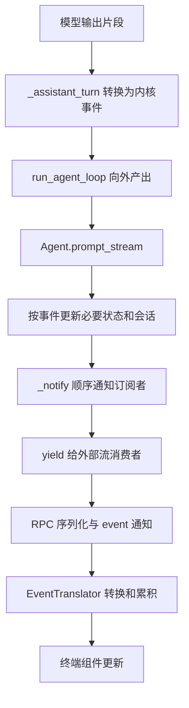

# 01｜只读事件与执行观察设计

> 学习目标：解释 Agent 怎样把执行过程提供给界面、日志和扩展，并说清本项目为什么采用当前方案、其他项目怎样处理同一问题。
>
> 对应截图关键词：调度内核层的“14 类只读事件”。本节只围绕执行观察机制；专用 Hook 的拦截规则留给下一节。

## 1. 从一个业务场景理解问题

用户要求：“读取项目配置文件，解释配置是怎样加载的。”Agent 可能先调用读取工具，再根据文件内容生成解释。期间，用户需要看到正在进行的工作，程序还可能需要记录耗时、错误和工具使用情况。

这里至少有三类需求：

- **完成任务**：请求模型、处理工具调用、把结果交回模型。
- **展示过程**：逐步显示文本，展示工具调用状态，在结束时更新界面。
- **观察执行**：记录日志、收集统计，给扩展提供运行信息。

它们关心同一次运行，却不必全部写在同一个循环里。事件设计要解决的是：用什么接口暴露执行过程，才能让外围功能理解并使用这些信息，同时保持执行逻辑容易维护。

对业务开发者而言，这涉及前后端通信、状态更新、扩展接入和故障定位。掌握它，需要能说明状态从哪里来、如何传递、消费者失败以后会怎样。

## 2. 先区分四个容易混淆的概念

### 2.1 消息：对话中有哪些内容

消息可能来自 user、assistant 或 tool。例如，工具读到的文件文本可以成为一条工具结果消息，供下一次模型调用使用。

消息主要回答：“当前对话包含什么内容？”

### 2.2 事件：执行过程发生了什么

事件可以表达一轮开始、消息增加一段内容、工具处理结束、发生上下文压缩等事实。它可能携带消息，也可能携带工具参数、错误标记或统计值。

事件主要回答：“执行现在走到了哪里，刚刚发生了什么？”

### 2.3 决策接口：允许改变什么

某些需求需要阻止工具、修改参数或改写发往模型的上下文。这需要执行流程主动读取一个决策结果。

本项目采用专用 Hook 和 `HookResult` 承担这类控制。普通事件订阅者的返回值不进入该控制协议。这是接口契约的分工，不代表观察者在 Python 中天然没有副作用。

### 2.4 事件溯源：状态从哪里恢复

通知界面用的事件，可以只存在于内存中。事件溯源则把事件日志作为重建业务状态的主要依据，进一步涉及顺序、重放、兼容和持久化。

因此，“提供事件”和“采用事件溯源”是两个不同层次的设计决定。本项目的执行通知与 DeepSeek Harness 的 Session 事件日志，不能只因为都叫 Event 就视为同一种架构。

## 3. 面对这个问题，可以选哪些方案

### 3.1 执行代码直接更新界面和日志

优点是调用直观、追踪方便，适合非常小的单入口程序。随着界面、监控、插件增加，执行层需要知道的外围功能也会增加，修改时要同时考虑更多职责。

### 3.2 在特定位置调用特定回调

例如 `stream_delta_callback`、`tool_progress_callback`。接入方能明确知道自己收到什么，入口之间也容易按需适配。代价是接口种类可能不断增加，跨入口统一记录时需要适配不同载荷。

### 3.3 产生统一类型事件，由外层分发

循环输出 `MessageUpdate`、`ToolExecutionEnd` 等类型化对象，外层根据类型处理。这是 my-agent 本节采用的主要形式。它把执行观察接口统一起来，但仍必须决定回调是否等待、失败是否传播、载荷能否修改。

### 3.4 建立事件日志和状态投影

进一步把事件写入有顺序的日志，再从日志构造消息、界面状态和其他视图。适用于恢复、审计和多消费者一致性要求较强的系统，也会增加日志结构演进、存储、回放和投影维护成本。

这些方案可以组合。一个系统可以同时拥有直接显示回调、插件观察队列，以及持久化业务事件。比较开源项目时，首先要确定比较的是哪一层。

## 4. my-agent 的事件契约

### 4.1 为什么是 14 类

当前 `events.py` 定义了 14 个事件子类，不计 `Event` 基类：

| 层次 | 事件类型 | 观察对象 |
| --- | --- | --- |
| 一次执行 | `AgentStart`、`AgentEnd` | 整次输入处理的开始、结束及结果信息 |
| 一轮推理 | `TurnStart`、`TurnEnd` | 一次助手响应及后续工具处理的轮次边界 |
| 消息 | `MessageStart`、`MessageUpdate`、`MessageEnd` | 消息开始、增量变化和结束 |
| 工具处理 | `ToolExecutionStart`、`ToolExecutionUpdate`、`ToolExecutionEnd` | 工具调用进入处理、进度和结果 |
| 内部变化 | `ContextCompacted`、`ToolsChanged` | 上下文压缩与工具集合变化的通知契约 |
| 重试 | `AutoRetryStart`、`AutoRetryEnd` | 重试等待、恢复或失败的信息 |

14 是当前契约的分类数量，不是一次任务的事件数量，也不直接代表功能强弱。一次任务可以产生多条 `MessageUpdate`，也可能完全没有重试事件。事件的定义是否已经在所有相关路径接通，需要另外核验。

阅读位置：[events.py](C:/Users/MLL/Desktop/my-agent-harness/src/my_agent_core/events.py:35)。

### 4.2 “只读”准确保证了什么

事件使用 `@dataclass(frozen=True)`。正常属性赋值或删除受到限制，例如给已有 `TurnStart` 重新设置 `iteration` 会触发 `FrozenInstanceError`。基类在初始化时自动设置时间戳。

但它没有递归冻结载荷：

- `AgentEnd.messages` 可以引用列表。
- `ToolExecutionStart.args` 可以引用字典。
- 消息事件可以引用可变的 Message 对象。

因此应分开描述两件事：事件外层字段受到冻结约束；内部对象仍需要调用方遵守约定。把消息塞进 frozen dataclass，并不自动得到一个独立的历史快照。

如果多个消费者拿到同一对象引用，某个消费者修改嵌套内容，其他消费者可能观察到变化。要进一步强化隔离，可以考虑复制、JSON 快照或深冻结，但它们都有处理成本，对复杂载荷也有约束。是否值得增加，需要根据使用场景决定。

### 4.3 “只读观察”与字段冻结不是同一保证

字段冻结约束对象如何被修改；观察协议约束执行流程如何解释回调返回值。my-agent 的 `_notify` 不把 `False` 或其他普通返回值当成阻断指令。

订阅者仍可能访问外部对象、做 I/O 或抛异常，所以“事件是只读观察接口”不能外推成“任意观察者都不可能影响运行”。

## 5. 从模型片段到终端显示的完整路径

### 5.1 主链



图中是数据传递与处理顺序，不表示每条箭头都开了线程，也不表示回调与主流程天然并行。

### 5.2 模型层怎样变成 Agent 事件

`_assistant_turn` 消费模型层的流式输出，把文本、思考等更新转换为核心事件。以文本为例，`MessageUpdate` 携带当前消息状态和这次新增的 `StreamChunk`。

这里的适配价值是：外层消费者使用 Agent 的事件契约，不必直接理解每个模型 Provider 的原始流格式。终端渲染也没有被塞进 `_assistant_turn`。

阅读位置：[loop.py::_assistant_turn](C:/Users/MLL/Desktop/my-agent-harness/src/my_agent_core/loop.py:105)。

### 5.3 Agent 外壳做了哪些工作

`Agent.prompt_stream` 消费内核事件，按事件类型完成必要的状态处理。例如，消息结束时会按条件更新 Session。随后它先调用 `_notify`，再把事件 `yield` 给调用方。

这形成两种消费入口：注册到 Agent 的观察者回调，以及直接遍历事件流的外部调用方。会话保存由这里的显式处理完成，不能描述成“订阅一个日志监听器就自动把全部事件持久化”。

阅读位置：[agent.py::Agent.prompt_stream](C:/Users/MLL/Desktop/my-agent-harness/src/my_agent_core/agent.py:444)。

### 5.4 事件怎样跨进程

编码业务门面把事件流交给 RPC 服务端。服务端调用 `serialize_event`，再发送 `method="event"` 的 JSON-RPC 通知。前端转换器把通知转成界面可用的数据。

对文本更新来说，序列化会把增量放入 `delta` 等字段，`EventTranslator` 再累积文本。模型流里的工具调用增量不会完整地沿同一个文本更新字段显示；界面的工具调用项在本节核对的路径中由 `tool_execution_start` 创建。

阅读位置：[serialization.py::serialize_event](C:/Users/MLL/Desktop/my-agent-harness/src/my_coding_agent/serialization.py:78)、[EventTranslator.translate](C:/Users/MLL/Desktop/my-agent-harness/my-tui/src/bridge/event-translator.ts:152)。

### 5.5 一次正常读文件任务的简化顺序

```text
AgentStart
  用户消息开始 / 结束
  TurnStart(1)
    助手消息开始 / 更新 / 结束：提出 read 调用
    ToolExecutionStart(read)
    [可选的工具进度更新]
    ToolExecutionEnd(read)
    工具结果消息开始 / 结束
  TurnEnd(1)

  TurnStart(2)
    助手消息开始 / 多次文本更新 / 结束：解释文件
  TurnEnd(2)
AgentEnd
```

这是一个读取成功、随后正常回答的场景示意。拦截、截断、重试、取消及多工具批次会产生其他分支，不能把这份顺序当成任意请求必须严格遵守的固定清单。

尤其注意：`ToolExecutionStart` 在权限审查前发出，代表工具调用进入预检处理。观察到它，不能单独证明文件已经被读取或命令已经执行。

## 6. 回调的等待与错误语义

### 6.1 my-agent 的实际选择

`subscribe` 注册监听器并返回退订函数。`_notify` 使用订阅者列表的快照，按顺序调用回调；如果返回的是 awaitable，就等待它完成。

因此，本事件的后一个监听器通常要等前一个返回，事件继续向外传递也要等 `_notify` 返回。列表快照还意味着：当前分发期间的订阅变动，与下一次事件采用的订阅集合需要区分。

普通返回值没有拦截含义。返回 `False` 不会自动取消工具，也不会成为模型决策。

阅读位置：[Agent.subscribe](C:/Users/MLL/Desktop/my-agent-harness/src/my_agent_core/agent.py:302)、[Agent._notify](C:/Users/MLL/Desktop/my-agent-harness/src/my_agent_core/agent.py:541)。

### 6.2 这个方案的收益

- 顺序直观，容易解释和编写小型测试。
- 异步观察者的完成时机有明确等待关系。
- 不需要为每个观察者维护工作线程、队列、容量和退出协议。

### 6.3 这个方案的代价

- 慢监听器会拖慢分发，不能因为函数用了 `async` 就认为它不会影响主流程。
- 普通 `Exception` 被逐回调抑制，本函数没有主动记录这些异常，扩展故障可能不容易被注意到。
- `CancelledError` 属于 `BaseException`，不在 `suppress(Exception)` 的覆盖范围内；不能把该实现解释为“任何异常都不会传播”。

此外，外部调用方以异步迭代消费事件，消费者推进速度也会影响这条生成器调用链。这不等于对底层网络缓冲或模型推理服务作出了全局背压保证。

## 7. 为什么事件观察不等于事件溯源

my-agent 的核心执行事件用于描述过程，Session 则维护对话及相关状态条目。这里没有证据表明所有 `MessageUpdate`、工具进度或重试通知都成为唯一可恢复的持久化事实。

一个简单判断方法是问：清空所有运行通知以后，系统主要依靠什么恢复会话？如果仍然依靠独立保存的消息或 Session 条目，就不能仅凭有事件流而称为全事件溯源。

事件溯源进一步要求明确：

1. 哪些事件必须进入事实日志，哪些只是临时展示信息。
2. 事件顺序、标识和重放起点怎样定义。
3. 更新投影和写日志之间如何处理失败。
4. 新旧事件结构怎样兼容。
5. 内存提交、持久化完成和消费者处理完成分别代表什么。

这些额外机制有实际用途，也带来维护负担。学习 my-agent 时，应先理解现有通知机制，再判断业务是否真的需要更强的恢复和审计语义。

## 8. Pi：统一事件契约，并等待观察者

本节按用户指定的 `earendil-works/pi` 核验。它的 Agent 层用 TypeScript 的 `type` 判别联合定义 `AgentEvent`，提供 `subscribe`，并在 `processEvents` 中消费事件、更新内部状态后通知监听器。

关键特征：

- 观察者签名允许 `Promise<void> | void`，还包含 `AbortSignal`。
- `processEvents` 逐个等待监听器，订阅者的延迟会影响本轮收尾。
- 本节选取的 `processEvents` 分发段没有像 my-agent 一样逐监听器 `suppress(Exception)`；返回的 Promise 拒绝会让该方法失败，上层最终如何处理需要继续追调用方。
- 类型定义没有替调用方提供运行时深冻结保证。

这与 my-agent 有相近的统一事件接口和等待语义，但错误隔离策略不同。Pi 在自己的事件处理器中更新状态，并不违反“观察回调没有决策返回值”的分工：内部状态归约与外部监听器返回控制命令是两件事。

设计启发：想保留简单、顺序明确的订阅机制时，可以选择等待观察者；同时必须明确观察者失败是否应该使运行失败。

源码：[Pi AgentEvent](https://github.com/earendil-works/pi/blob/a05e3a07763c38d23d50207742f7e073e35cd0f8/packages/agent/src/types.ts#L528)、[subscribe](https://github.com/earendil-works/pi/blob/a05e3a07763c38d23d50207742f7e073e35cd0f8/packages/agent/src/agent.ts#L275)、[processEvents](https://github.com/earendil-works/pi/blob/a05e3a07763c38d23d50207742f7e073e35cd0f8/packages/agent/src/agent.ts#L575)。

## 9. oh-my-pi：观察者异步工作不进入主流程等待

`can1357/oh-my-pi` 同样使用 `AgentEvent` 判别联合和 `Set` 订阅者。Agent 处理运行事件、更新状态以后，通过 `#emit` 扇出通知。

与 Pi 的关键差别在 `#emit`：它直接调用监听器，捕获同步异常并记录警告；如果得到 Promise，就附加拒绝处理，但不等待 Promise 完成。

因此应准确地说：**异步监听器的完成不进入主流程的等待链，慢同步监听器仍会占用当前调用栈。** 把这个实现概括为“回调完全不阻塞”是不准确的。

收益是外围异步观察工作通常不会拖住 Agent 收尾，错误也有日志出口。代价是主流程完成不能自动代表观察者的异步工作已经完成；若要保证某项异步工作完成，仍需要独立协议。

本节没有据这些 Agent 层片段判断整个 oh-my-pi 的产品级持久化或回放能力。此处讨论的是运行通知的分发选择。

源码：[oh-my-pi AgentEvent](https://github.com/can1357/oh-my-pi/blob/f0200abf28e8d314125854600cf726dece495246/packages/agent/src/types.ts#L1317)、[subscribe](https://github.com/can1357/oh-my-pi/blob/f0200abf28e8d314125854600cf726dece495246/packages/agent/src/agent.ts#L1002)、[#emit](https://github.com/can1357/oh-my-pi/blob/f0200abf28e8d314125854600cf726dece495246/packages/agent/src/agent.ts#L2370)。

## 10. Hermes：平台回调与插件流观察分层

Hermes 本节展示了两个需要分开的层次。

第一层是平台入口回调。官方 Agent Loop 文档列出文本增量、工具进度、步骤、状态和交互等回调，服务于 CLI、gateway 和 ACP 等入口。`stream_delivery.py` 中的显示 / TTS 回调路径采用直接调用和普通异常处理。

第二层是插件的流生命周期观察。`plugin_stream_hooks.py` 为每个相关插件回调维护独立的有界队列和 daemon worker，队列容量为 1024。队列满时先丢弃最旧待处理项，再尝试放入新项；仍失败时记录调试信息并返回失败。

这个设计优先保护流式输出路径。慢插件有机会丢失观察事件，所以它适合进度观察或辅助扩展，不能直接充当“每条记录必须处理成功”的账本。

还要避免把两层合成一个结论：Hermes 的插件流 hooks 异步处理，不代表它所有平台显示回调都不阻塞；而直接显示回调没有抛异常，也不等于数据已被持久化或用户已经看见。

设计启发：多入口助手可以分别管理用户交互和插件观察的延迟、错误与丢失策略。机制更丰富以后，也需要更清楚的接口说明和诊断能力。

源码：[平台回调说明](https://github.com/NousResearch/hermes-agent/blob/4124b34ff9ddaeebd3af831ff0c3d22a464cec2f/website/docs/developer-guide/agent-loop.md#L165)、[插件流队列](https://github.com/NousResearch/hermes-agent/blob/4124b34ff9ddaeebd3af831ff0c3d22a464cec2f/agent/plugin_stream_hooks.py#L22)、[队列与 worker 实现](https://github.com/NousResearch/hermes-agent/blob/4124b34ff9ddaeebd3af831ff0c3d22a464cec2f/agent/plugin_stream_hooks.py#L42)、[显示回调](https://github.com/NousResearch/hermes-agent/blob/4124b34ff9ddaeebd3af831ff0c3d22a464cec2f/agent/stream_delivery.py#L52)。

## 11. DeepSeek Harness：追加事件同时形成会话事实日志

DeepSeek Harness 的 `Session.append` 不只是给外部发一条通知。它把事件追加到 Session 日志，分配会话内的 `seq` 和时间，校验载荷，再向观察者通知。

这里的事件通过 `type` 和对应 `data` 建模。某些消息表面事件还携带来源事件序号等元数据，便于从日志理解和构造派生视图。

### 11.1 快照与不可变边界

所核验的 `append` 路径会复制输入数据并深冻结新事件，避免日志继续引用调用方随时可修改的输入。这比 my-agent 外层 dataclass 浅冻结提供了更强的快照边界。

但不同辅助入口不能混为一谈：`adoptSessionEvent` 接受已有事件，在相应消息载荷上校验和冻结；`snapshotSessionEvent` 则先做 `structuredClone`。比较“是否复制”和“冻结到哪层”时，必须指出具体入口。

### 11.2 先提交内存日志，再通知观察者

提交时先取得观察者快照，事件进入内存日志后，再逐个同步调用观察者。同步异常被隔离，Promise 拒绝有处理，但 Promise 不被等待。

重要的是：观察者失败不会自动撤回已经接受的内存日志事件。这明确区分了事实提交和观察处理。

### 11.3 日志提交不等于磁盘持久化完成

该热路径不直接做磁盘 I/O，持久化属于插件职责。`append` 返回不能直接解释成已完成磁盘写入，更不能直接外推成所有消费者处理完成。

设计启发：会话恢复、审计和多种派生视图成为主要需求时，可以让事件日志承担事实来源。代价是需要维护事件结构、投影、存储边界和兼容规则。

源码：[SessionEvent 契约](https://github.com/deepseek-ai/deepseek-harness/blob/fcc0ad462172522aaf5c93a7b2e01f6b9f0b0159/packages/core/session/src/types.ts#L287)、[Session.append](https://github.com/deepseek-ai/deepseek-harness/blob/fcc0ad462172522aaf5c93a7b2e01f6b9f0b0159/packages/core/session/src/index.ts#L806)、[提交与通知](https://github.com/deepseek-ai/deepseek-harness/blob/fcc0ad462172522aaf5c93a7b2e01f6b9f0b0159/packages/core/session/src/index.ts#L888)、[观察者错误隔离](https://github.com/deepseek-ai/deepseek-harness/blob/fcc0ad462172522aaf5c93a7b2e01f6b9f0b0159/packages/core/session/src/index.ts#L400)。

## 12. OpenCode：区分实时订阅、可恢复日志与远端交付

本节核验的 OpenCode 快照中，核心代码已位于 `packages/core`，不是一些旧文章使用的 `packages/opencode/src` 路径。

`Bus` 明确区分两种消费需求：`subscribe()` 是易失的实时通道，接收从订阅之后发布的事件；需要有序历史和恢复的消费者使用按 aggregate 组织的 `log()`。后者支持指定起点以及历史读取后继续跟随。

事件定义又区分 durable 和 ephemeral。不能把实时收到事件解释成它一定可恢复，也不能把存在 durable 能力解释成所有事件都写盘。

本节所读 `configured()` 的 `persist` 选项默认是 `false`，写事件表的路径检查该选项。实际产品组合层怎样启用持久化，不在本节取样范围内。

服务器的 `EventFeed` 在实时交付时为订阅者维护有界队列，所核验工厂的默认容量为 4096。观察到队列溢出时，会移除该订阅者并以溢出错误结束它。这里采用了明确失败的策略；客户端如何重连，以及如何把历史日志与实时流衔接，还需要追客户端接线，不能假定自动可靠回放。

设计启发：面向多个客户端时，状态恢复、实时通知和网络消费者速度是三类不同问题，分别给出接口和失败语义，比让一个万能 listener 隐含承担所有保证更容易解释。

源码：[Bus.subscribe / log 接口](https://github.com/anomalyco/opencode/blob/57719d7fd400721783a059fee78c7d33a21cd9b6/packages/core/src/bus.ts#L132)、[持久化配置](https://github.com/anomalyco/opencode/blob/57719d7fd400721783a059fee78c7d33a21cd9b6/packages/core/src/bus.ts#L204)、[EventFeed 队列交付](https://github.com/anomalyco/opencode/blob/57719d7fd400721783a059fee78c7d33a21cd9b6/packages/server/src/event-feed.ts#L34)。

## 13. 把六个项目放在相同维度上比较

下表只比较本节选取的层次。它不表示这些项目只有表中列出的机制。

| 项目 | 本节观察层 | 分发与等待 | 慢消费者 / 错误处理 | 历史与恢复的边界 |
| --- | --- | --- | --- | --- |
| my-agent | 核心执行事件、Agent 订阅、RPC 转换 | 逐个调用，等待 awaitable | 慢监听器拖慢分发；普通异常被抑制 | 事件流与 Session 消息持久化分工，不是全执行事件溯源 |
| Pi | AgentEvent 与 processEvents | 更新内部状态后，逐个 await 监听器 | 当前分发段未见逐监听器异常隔离；需追上层失败处理 | 本节 Agent 层片段不能代表产品层存储与回放 |
| oh-my-pi | AgentEvent 与 #emit | 同步调用，不等待异步返回完成 | 同步异常和 Promise 拒绝记录警告；慢同步代码仍占用主调用栈 | 异步观察完成没有被主流程收尾自动等待；产品层历史未在此核验 |
| Hermes | 平台显示 callbacks 与插件 stream hooks | 显示直接调用；插件流观察入独立队列 / worker | 插件队列满时优先丢旧项；显示路径有自己的错误处理 | 插件观察队列不是可靠持久化账本 |
| DeepSeek Harness | Session typed append-only 事件日志 | 先接受内存日志，再同步通知；不等待 observer Promise | 逐观察者隔离异常和拒绝；慢同步观察者仍耗时 | 日志是派生视图的依据；磁盘持久化由独立插件承担 |
| OpenCode | Bus、aggregate 日志与服务器 EventFeed | 实时 Stream 与有序 log 分开；远端交付经队列 | EventFeed 队列满则明确终止该订阅；可靠恢复需独立接线 | 区分 durable / ephemeral，写历史受配置控制；实时流本身易失 |

可以从中提炼出四个不同的设计问题：

1. **统一什么**：统一运行过程的类型，还是统一能够重建状态的事实日志？
2. **等待谁**：主流程必须等哪个消费者完成，哪个消费者可以晚一点甚至丢一些进度？
3. **失败影响谁**：一个观察者报错，是只影响自己，还是让事件处理甚至任务失败？
4. **恢复依靠什么**：消息存储、持久事件日志、客户端快照，还是多种机制组合？

这些问题比“用了观察者模式”更能解释系统的实际行为。观察者模式只说明谁通知谁，还没有回答交付保证和失败语义。

## 14. 从设计角度评价 my-agent 的选择

### 14.1 哪些地方适合当前项目

当前项目需要一套能被 Python 内核、编码门面、终端界面和扩展共同理解的执行观察接口。统一事件类型、异步生成器输出及小型订阅器，使这条链容易追踪。

状态与展示也有相对清楚的落点：内核组织执行；Agent 处理必要状态；序列化层解决进程边界；前端转换器处理界面表达。这些职责能分别定位和测试。

对于当前学习目标，这说明项目已经在考虑真实应用的集成问题：执行过程需要跨层传递，同时保留接口边界。

### 14.2 哪些边界必须诚实说明

- 事件载荷没有完全深冻结。
- 观察者没有独立超时和统一的队列容量管理。
- 等待监听器会把观察延迟带进执行推进。
- 普通监听异常被静默抑制，诊断能力有限。
- 没有由这条事件接口本身证明的远端补发、全局顺序或可靠重放保证。

这些边界不自动意味着必须重构。应先根据故障和需求确定要强化哪种保证，避免仅为“看起来像大型框架”增加机制。

### 14.3 遇到不同业务约束，可以怎样取舍

**需要准确控制行为的逻辑**，例如权限审查，应留在执行流程明确等待的决策接口中。不能依赖可能晚到或丢失的进度观察者。

**必要的状态保存**，需要明确何时算成功、失败怎样处理。若由执行层显式调用 Session 保存，就按这个契约讲；若改成可靠事件日志，就必须一并设计持久化和恢复。

**界面进度与辅助遥测**，可以根据用户体验选择等待、合并更新或异步有界队列。采用有损队列时，需要说明哪些事件允许丢失，并为终态提供独立保障。

**远端客户端恢复**，需要历史起点、事件标识、快照或日志接续协议。只把进程内事件转成 JSON，并不会自动拥有这些保证。

这些是设计分析与可选方向，本节没有修改运行时代码，也没有声称已经实现上述增强。

## 15. 与未来 Agentic RL Harness 的联系

统一事件接口有助于记录执行过程，但可展示的过程不自动等于可训练的数据。

如果以后扩展为训练 Harness，需要确定一条轨迹怎样关联运行 id、轮次、工具调用、模型与 Harness 版本、模型实际输入、工具观察、终止原因及奖励来源。文本增量适合展示，未必足以重建训练时真实采用的上下文和采样结果。

因此可以把本节理解为“执行可观察”的基础。训练还需要专门的数据契约、任务验证和版本管理。这里是面向未来的设计延伸，不是当前项目已完成训练闭环的证明。

## 16. 面试时怎样讲

### 16.1 三十秒表达

> 项目把 Agent 执行过程表示为一组类型化事件，通过异步生成器向外输出。界面、日志和扩展可以消费同一份执行信息，内核减少了对展示逻辑的依赖。普通事件订阅承担观察，执行拦截由专用 Hook 承担。当前实现按顺序等待监听器，因此接口简单，但慢监听器会影响分发速度，载荷也只有浅层冻结。

这是对项目设计的表达，不是个人职责声明。个人主导了哪些部分，需要结合真实开发经历另行说明。

### 16.2 深入追问：为什么不在循环里直接更新界面

因为执行层还会服务评测、脚本或其他入口。直接调用某一种界面，会让内核知道更多外围细节。统一事件让这些消费者依赖同一套执行契约。对应代价是要维护事件类型、序列化和消费者之间的兼容，不能只讲解耦收益。

### 16.3 深入追问：14 类事件有什么特别之处

关键是生命周期覆盖和粒度合理。Agent、Turn、Message、Tool 分别表达不同层次，压缩和重试表达运行状态变化。14 是当前枚举结果，换一个版本或分层可能得到其他数量。比较 Pi 或 oh-my-pi 时，应该比较语义和交付方式，不以数字判断完整程度。

### 16.4 深入追问：只读是否保证插件不能改执行

不能这样保证。frozen dataclass 限制外层字段，嵌套对象仍可能可变；监听器还可以访问其他对象。当前协议保证的是普通返回值不作为拦截决策。真正的强隔离或完全不可变，需要额外机制和证据。

### 16.5 深入追问：为什么等待观察者，怎样处理慢消费者

等待让完成时机和顺序容易理解，也省去队列和 worker 的生命周期管理。代价是主链受到观察延迟影响。是否改成异步，要看消费者的重要性：辅助进度可以允许合并或丢弃；正确性依赖的数据需要更强的完成与恢复契约。oh-my-pi、Hermes 和 OpenCode 展示了不同的处理选择。

### 16.6 深入追问：事件能否用来更新状态

可以。Pi 的 `processEvents` 就先依事件更新内部状态，再通知外部监听器。需要区分“状态机消费事实”与“外部监听器返回命令影响执行”。把观察和控制分开，并不意味着系统不能采用事件归约状态。

### 16.7 深入追问：这个项目与 DeepSeek Harness 的事件设计差在哪里

本项目的核心事件主要暴露执行过程，消息和 Session 条目承担会话保存。DeepSeek Harness 的 Session append 同时建立 typed 事件日志，并从这个事实基础派生视图。后者还明确处理事件序号、快照、冻结与日志提交。但它的内存 append 仍不能直接解释为磁盘持久化完成。

### 16.8 深入追问：流式接口能不能断线恢复

需要查看独立协议。进程内订阅、跨进程通知、远端实时流、历史日志读取分别解决不同问题。OpenCode 在本节代码中明确区分易失 `subscribe` 和有序 `log`，服务器还会对慢订阅者队列溢出明确报错。是否自动重连并补齐历史，要继续核验客户端。

## 17. 学完后的一个复述任务

以“模型读取文件后解释内容”为例，口头串起以下三段：

1. 模型的一段文本怎样变成 `MessageUpdate`，再到终端。
2. 工具处理结束事件，与工具结果消息为什么分别存在。
3. 如果一个监听器很慢、返回 `False` 或抛出普通异常，my-agent 分别怎样处理；换成 oh-my-pi 或 Hermes 的插件流观察，行为又有什么不同。

先回答每一段的输入、下一步和输出，再补充取舍。遇到某一步不清楚，可以只带读该函数的十几行代码。

## 18. 原作者博客：参考什么，怎样避免混用版本

本节参考原作者的两篇文章：

- [Agent 类与 Hook 系统](https://zxj-2023.github.io/2026/07/31/学习/agent实战/my-pi-agent/my-pi-agent--agent类与hook系统/)：理解生命周期与观察接口的设计动机。
- [Loop 微内核](https://zxj-2023.github.io/2026/08/30/学习/agent实战/my-pi-agent/my-pi-agent--loop微内核/)：理解独立循环向外产出事件的组织方式。

文章包含架构演进前后的片段，能看到早期把工具执行事件当作 Hook 目标的用法，也有后来明确区分 Event 与 Hook 的说明。学习时采用当前本机代码的消费协议：事件回调普通返回值不作为控制决策，专用 Hook 结果才被拦截流程读取。

文章中的性能倍数、内存收益、其他版本特性，不直接作为本机已复现事实。对本节而言，博客用于理解设计背景，源码用于确认行为，测试用于核对具体契约。

## 19. 版本、证据范围与验证记录

核验日期：2026-11-10。外部仓库以 GitHub 插件读取并固定到以下 commit；链接均使用对应快照，避免后续默认分支变动导致行号和结论漂移。

| 项目 | 快照 | 本节读取范围 |
| --- | --- | --- |
| 本机 my-agent | HEAD `a9e908b`，相关核心文件未见工作区差异 | events、Agent 分发、loop 事件产生、序列化及前端转换的关键段；会话语义沿用已核验调用链 |
| Pi | `a05e3a07763c38d23d50207742f7e073e35cd0f8` | `packages/agent/src/types.ts` 的 AgentEvent，`agent.ts` 的 subscribe / processEvents 等片段 |
| oh-my-pi | `f0200abf28e8d314125854600cf726dece495246` | `packages/agent/src/types.ts` 的 AgentEvent，`agent.ts` 的订阅、状态更新及 #emit |
| Hermes | `4124b34ff9ddaeebd3af831ff0c3d22a464cec2f` | `agent/plugin_stream_hooks.py`、`agent/stream_delivery.py` 关键段及官方 Agent Loop 回调文档 |
| DeepSeek Harness | `fcc0ad462172522aaf5c93a7b2e01f6b9f0b0159` | `packages/core/session/src/types.ts`，`index.ts` 的快照、冻结、append 与观察者分发段 |
| OpenCode | `57719d7fd400721783a059fee78c7d33a21cd9b6` | `packages/core/src/bus.ts`、`packages/server/src/event-feed.ts`、`packages/schema/src/event.ts` 关键段 |

核验方式：DS 助手按小范围片段读取与分析；主代理检查版本、关键分发实现、交付语义和文档表述。外部项目未在本机安装或运行，未进行跨框架性能测试。

本机 `tests/core/test_events.py` 在上一小节执行，4 项通过，覆盖事件相关契约。当前核心事件与 Agent / loop 文件相对该次核验未变；本节整理比较文档没有重复执行全库测试。该结果不证明所有并发、取消或外围插件场景都已覆盖。

未核验范围包括：Pi 监听失败的完整外层收尾、oh-my-pi 产品级全部存储、Hermes 其他所有 hooks、DeepSeek 持久化插件的磁盘保证、OpenCode 产品组合层持久化开关和客户端断线恢复。上述范围不应被写成已实现或未实现的全局结论。
